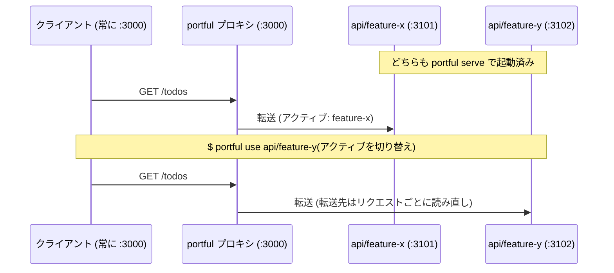

# portful

[English](README.md)

git worktree でブランチを並行開発していても、そのサーバを見るクライアント(たとえばフロントエンドの dev サーバ)が叩くポートはひとつです。
worktree を切り替えるたびに、いま動いているサーバを止めて、別の worktree で立ち上げ直すことになります。
`portful` はこの立て直しをなくすツールです。
worktree ごとにバックエンド(たとえば Rails アプリ)のサーバを別ポートで起動したままにします。
固定ポートで待ち受ける小さなリバースプロキシが、そのうち「アクティブ」な worktree にリクエストを転送します。
切り替えは次のリクエストから反映されます。
クライアントの再起動も `.env` の書き換えも `cd` も要りません。

名前は [portless](https://portless.sh/) への返答です。
portless はポート番号を `.localhost` の名前に置き換えますが、portful ではポートが主役です。
すべてのクライアントが見る固定ポートが 1 本あり、その後ろで worktree ごとにもう 1 本ずつ動きます。
同じことをする部分では portless のコマンドと設定の形をそのまま借りているので、portless を使っている人はもう一冊マニュアルを読まずに使えます。
[portless から来た人へ](#portless-から来た人へ)を参照してください。

direnv やシェルの alias のようなディレクトリ単位のツールが影響できるのは、これから起動するプロセスだけです。
すでに動いているクライアントの向き先は変えられません。
その「すでに動いているクライアントの向き先を変える」ことが、portful の存在理由です。

- いまいる worktree のサーバを起動: `portful`(= `portful run`)
- worktree を指定してサーバを起動: `portful serve api/feature-x`
- プロキシの向き先 worktree を切り替え: `portful use`
- 各固定ポートの現在の行き先を一覧: `portful list`
- worktree に `cd` せずに単発コマンドを実行: `portful exec`

## これが不要な人

- git worktree をそもそも使っていないなら、出番はありません。
- クライアント側を気軽に再起動できる、あるいは接続先を env 変数や設定ファイルから読み直せる構成なら、そのポートを直接向ければ済みます。
- 同時に動かす worktree が常にひとつだけなら、従来通り `cd` して立ち上げ直すだけで十分です。

## portless から来た人へ

[portless](https://github.com/vercel-labs/portless) はアプリごとに `.localhost` の名前を配り、ホスト名で転送先を決めます。
portful はリポジトリごとに固定ポートを 1 本持ち、いまアクティブな worktree で転送先を決めます。転送先はリクエストのたびに読み直します。
答えている問いが違うので、両方使う手もあります。portless の alias を portful の固定ポートに向ければ、名前は portless、切り替えは portful が担当します。

同じ意味のコマンドは同じ名前です:

| portless | portful |
| --- | --- |
| `portless` | `portful` |
| `portless run` | `portful run` |
| `portless <name> <cmd...>` | `portful <repo> <cmd...>` |
| `portless list` | `portful list` |
| `portless proxy start` / `stop` | `portful proxy start` / `stop` |
| `portless doctor` | `portful doctor` |
| `portless prune` | `portful prune` |
| `portless clean` | `portful clean` |

設定の置き方も同じです。リポジトリの中の `portful.json`、または `package.json` の `"portful"` キーを読み、優先順位も portless に合わせてあります。
子プロセスには `PORT`、`HOST`、`PORTFUL_URL` が渡るので、すでに `PORT` を読むサーバならテンプレートなしで起動します。

意図して違えてある点が 4 つあります。

- **アドレスは名前ではなくポートです。** これが目的そのものです。`http://127.0.0.1:3000` をすでに握っているクライアントは、切り替えをまたいでそのまま動き続けます。cookie も同じです。
- **特権ポートも CA も `/etc/hosts` も使いません。** portful が書くのは自分の設定ディレクトリと状態ディレクトリだけで、あとは設定したポートを bind するだけです。管理された会社の端末でも、管理者権限なしで動きます。
- **`proxy start` はフォアグラウンドで動きます。** プロキシ 1 本につきタブ 1 枚にすれば、リクエストログが見えたまま `Ctrl-C` が停止ボタンになります。
- **`alias` はありません。** portless では別のホスト名ルートを足すコマンドですが、ここでは「アクティブな worktree を無視する」という別の動作になってしまいます。portful が起動していないサーバに届かせたいときは `portful <repo> <cmd...>` が担当します。

## 動作要件

- Node.js 20 以上(開発は Node 25 で実施)
- macOS または Linux(POSIX の `sh` とプロセスグループに依存し、ポート競合の診断に `lsof` を使います)
- `git`(worktree の列挙に `git worktree list` を使用)
- ピッカー([peco](https://github.com/peco/peco) / [fzf](https://github.com/junegunn/fzf))は任意。
  どちらかが `PATH` にあれば worktree の選択に自動で使われ、どちらも無ければ番号入力のプロンプトにフォールバックします

## インストール

```sh
npm install
npm link
```

`npm link` で `portful` 実行ファイルが `PATH` に入ります([tsx](https://github.com/privatenumber/tsx) 経由で動くためビルドは不要です。`src/` を編集すれば即座に反映されます)。
リンクせずに試したい場合は、チェックアウトから直接 `./bin/portful.js <command>` を実行できます。

## クイックスタート

```sh
# 1. リポジトリを登録(マシンごとに一度。どのリポジトリがどこにあるか)
mkdir -p ~/.config/portful
cat > ~/.config/portful/config.json <<'JSON'
{ "repos": { "api": { "path": "~/work/api" } } }
JSON

# 2. リポジトリにポートを与える。このファイルはチェックアウトの中に置くので、
#    コミットすれば同じ設定が全員に渡る。
cat > ~/work/api/portful.json <<'JSON'
{
  "fixedPort": 3000,
  "portRange": [3101, 3199],
  "serve": "bundle exec rails s -p {port}"
}
JSON

# 3. worktree ごとにサーバを立ち上げておく(ターミナルのタブを分けてフォアグラウンドで)
portful serve api/feature-x
portful serve api/feature-y      # 別のタブで

# 4. 固定ポートにプロキシを立てる(さらに別のタブ、これもフォアグラウンド)
portful proxy start api

# 5. 固定ポートの向き先を好きなタイミングで切り替える
portful use api                  # ピッカーが開き、次のリクエストから反映
```

`PORT` 環境変数を読むサーバなら `serve` は要りません。
書かずにおけば、worktree の中で `portful` を打つだけで、そのプロジェクトの `dev` スクリプトが `PORT` 付きで起動します。

同じ流れを図にすると、次のようになります。
2回目のリクエストは、何も再起動せずに feature-y に届きます:



この図は通常の HTTP リクエストの場合です。
WebSocket 接続は、開いたときに一度だけルーティングされます(「制約とトラブルシューティング」参照)。

プロキシは使うときだけ起動すれば十分です。
起動していないあいだは `fixedPort` を何も占有せず、他のコマンドはそれまで通りに動きます。

## 設定

設定は portless と同じく 2 階層に分かれます。

**ユーザ階層のファイル**は `$XDG_CONFIG_HOME/portful/config.json`(未設定なら `~/.config/portful/config.json`)です。
どのリポジトリがあってチェックアウトがどこにあるかを登録します。これはリポジトリの中のファイルには書けない情報です:

```json
{
  "repos": {
    "api":   { "path": "~/work/api" },
    "front": { "path": "~/work/front" }
  },
  "picker": { "command": "fzf --height 40% --reverse" }
}
```

**リポジトリ階層のファイル**は、リポジトリ本体のチェックアウトに置く `portful.json`、または `package.json` の `"portful"` キーです。
プロジェクトに属する設定を持ちます:

```json
{
  "fixedPort": 3000,
  "portRange": [3101, 3199],
  "serve": "bundle exec rails s -p {port}"
}
```

優先順位はひとつの規則です。ユーザ階層のエントリがリポジトリ階層の両方に勝ち、`package.json` のキーが `portful.json` に勝ちます(portless と同じ)。
ポートはマシンごとに割り当てるものなので、手元のマシンがリポジトリの提案に勝ちます。

この形になる前の設定からの移行は `portful migrate` が行います。古い `config.toml` を読んで `config.json` を書きます。

### キー

- `path`(ユーザ階層のみ)はリポジトリ本体のチェックアウトを指し、`~` 展開に対応します。
  portful は worktree を作りません。`git worktree add` で自分で追加してください。`git worktree list` に出るもの(本体のチェックアウトを含む)がすべて選択対象になります。
- `fixedPort` は他のサービスが常に叩くポートです。
- `portRange` は `[min, max]` で、各 worktree に割り当てるポートの範囲です。
- `serve` は省略できます。書いた場合は `sh -c` で実行され、`{port}` がその worktree に割り当てられたポートに置換されます。
  env 変数のプレフィックスも書けます(`"serve": "PORT={port} bin/dev"`)。
  書いた `serve` にはリテラルの `{port}` が必要です。無いと、サーバはフレームワークの既定ポートを bind する一方で、`status` とプロキシは割り当てたポートにいると信じ続けます。
- `script` は `serve` が無いときに実行する `package.json` のスクリプト名で、既定は `dev` です。
  パッケージマネージャは worktree のロックファイルから決めます。`pnpm-lock.yaml`、`yarn.lock`、`bun.lockb`、`package-lock.json` の順に見て、無ければ npm です。
- `serve` は `{<repo>.port}` で他の登録済みリポジトリのポートを参照できます。
  `front` のテンプレートを `"API_URL=http://127.0.0.1:{api.port} PORT={port} npm run dev"` にすると、`{api.port}` は `api` のアクティブな worktree が使っているポートに解決されます(まだ無ければ割り当てます)。
  複数リポジトリの worktree を結線したままにできるのはこの仕組みです。下の「タスク」に全体の流れがあります。
- `portful.json` に `name` を書く場合は、そのリポジトリを登録した名前と一致させてください。食い違うと、両方の名前を出して設定の読み込みに失敗します。

portful が起動するサーバには `PORT`、`HOST`、`PORTFUL_URL` が渡ります。
`PORTFUL_URL` はクライアントが使う固定ポートのアドレスで、その worktree 自身のポートではありません。

一度 `portful serve` したことのある worktree は、再起動をまたいで同じポートを使い続けます(sticky な割り当て)。
割り当て時にそのポートが埋まっていた場合だけ、`portRange` の次の空きポートを使います。
この占有チェックには限界があります(「制約」参照)。

設定を読み込む時点でリポジトリをまたいだポートの衝突を検査します。
2 つのリポジトリが同じ `fixedPort` を使うことはできず、`portRange` どうしも重なれません。
どのリポジトリの `fixedPort` も、どのリポジトリの `portRange`(自分自身のものを含む)にも入ってはいけません。
いずれも該当するリポジトリ名を挙げて、その場で読み込みに失敗します。

### https

すでに mkcert などの証明書で動いている worktree サーバのために、リポジトリは `https` オブジェクトを持てます:

```json
{
  "fixedPort": 3000,
  "portRange": [3101, 3199],
  "https": {
    "cert": "~/certs/localhost.pem",
    "key": "~/certs/localhost-key.pem",
    "backend": true
  }
}
```

- `cert`/`key` は固定ポートの listener 自体を TLS 終端します。
  mkcert が `localhost`/`127.0.0.1` 向けに発行したペアは、worktree のサーバがすでに信頼しているものと同じなので、そのまま指せることがほとんどです。
  両方を設定するか、両方省くかのどちらかです。どちらかのパスが存在しない、または読めない場合は、その場で設定の読み込みに失敗します。両方とも `path` と同じく `~` 展開に対応します。
- `backend`(既定 `false`)は、プロキシから worktree のサーバへの接続を http ではなく https にします。バックエンド自身が TLS 終端する構成向けです。
  `cert`/`key` とは独立です。平文 http の listener から https のバックエンドへも、TLS 終端する listener から平文 http のバックエンドへも、どの組み合わせでも動きます。
- `https` オブジェクトが無ければ、プロキシは平文 http で受けて平文 http で送ります。

portful は認証局を作りませんし、システムの信頼ストアにも触りません。すでに持っているペアを指してください。

### ピッカー

`use` と `task add` が worktree の選択に開くピッカーは、上のユーザ階層の `picker` オブジェクトで指定します。
候補行を stdin から読み、選ばれた行を stdout に出すコマンドなら何でも使えます。
未設定なら peco、次に fzf を自動検出し、どちらも無ければ番号入力のプロンプトになります。

設定ファイルが無い場合、`portful` はサンプルを表示して終了します。

## コマンド

ほとんどのコマンドは省略可能な `<repo>` または `<repo>/<worktree>` 引数を取ります。
`<repo>` だけならそのリポジトリの「アクティブ」な worktree が対象になります。
リポジトリ引数を省略した場合はカレントディレクトリから推測します(各リポジトリの本体チェックアウトと全 worktree に対して、シンボリックリンクを解決した上で照合します)。

### `portful` と `portful run`

いまいる worktree のサーバを起動します。portless と同じ形の入口です。
`portful` 単体は `portful run` と同じで、`portful run --name <repo>` ならリポジトリを推測せず名前で指定します。

何を実行するかは次の順です。リポジトリに `serve` テンプレートがあればそれ、無ければ `script`(既定 `dev`)が指す `package.json` のスクリプトを、worktree のロックファイルが示すパッケージマネージャ経由で実行します。
プロジェクトが定義していないスクリプト名を指した場合は、定義されているスクリプトの一覧を添えて報告します。

`run` は worktree をカレントディレクトリから取ります。
`serve` はリポジトリのアクティブポインタに従います。そのポインタこそこのツールが切り替えるためのものなので、2 つの動詞は別々の問いに答えます。

### `portful <repo> <cmd...>`

`serve` テンプレートの代わりに、渡したコマンドで `<repo>` のサーバを起動します。`portless <name> <cmd...>` と同じ形です:

```sh
portful api bundle exec rails s
portful api/feature-x npm run dev
```

worktree はカレントディレクトリから取ります。リポジトリの外にいる場合はアクティブポインタから取ります。
コマンドはシェルを介さず直接起動するので、引数は打ったとおりに届きます。ポートは `PORT` から読みます。

この節に挙がるコマンド名はすべて予約語です。`status` や `list` という名前のリポジトリは、位置引数の形ではなく `portful serve status` で指定してください。

### `portful use [repo]`

リポジトリの「アクティブ」な worktree を選びます。
`repo/worktree` 形式なら直接セットします。
`repo` だけ(または cwd から推測)ならピッカーが開きます。
ピッカーは `picker` で設定したコマンド、無ければ自動検出した peco か fzf、どれも無ければ番号選択のプロンプトです(「設定」参照)。
プロキシが稼働中なら、切り替えた瞬間から新しいアクティブ worktree にルーティングされます。
再起動は不要です。
その worktree のサーバがまだ起動していなければ、`use` は警告を出して `portful serve` の実行を促します。

### `portful serve [repo]`

アクティブな(または指定した)worktree のサーバを、その worktree のディレクトリで、割り当てポートを使ってフォアグラウンドで起動します。
すでにサーバが動いている worktree への重複起動は拒否します。
`SIGINT`/`SIGTERM` は子プロセスグループに転送されるので、`Ctrl-C` できれいに止まります。

`portful serve [repo] --direct` を付けると、`{port}` の置換値が通常の sticky ポートではなくリポジトリの `fixedPort` になります。
その worktree を、本番で bind されるのと同じ形でプロキシなしに動かすための、一時的な置き換えです。
sticky ポートの割り当ては一切変更しません。
リポジトリのプロキシがすでに稼働中なら拒否します(先に止めてください、そうしないと両方が `fixedPort` を取り合います)。
`fixedPort` をすでに他プロセスが占有している場合も拒否します(`portful proxy start` 自身の占有チェックと同じく `lsof` で表示します)。
起動したサーバのエントリは、`portful status`/`portful ui` にも通常のサーバと同じ形で表示され、ポートには `fixedPort` が記録されます。

### `portful exec [repo[/worktree]] <cmd...>`

worktree のディレクトリの中で任意のコマンドを実行します。
自分で `cd` する必要はありません。
たとえば `portful exec api bin/rails console`、そのリポジトリの中にいるなら単に `portful exec bin/rails console` と書けます。
内側のコマンドのフラグは一切加工されずに素通しされます(`exec` については `portful` はオプションパースを一切しません)。
`portful exec api bin/rails s -p 3105` は、手で実行したのと完全に同じように動きます。
対象 worktree がリポジトリの「アクティブ」な worktree から決まった場合(repo を省略した、または `/worktree` を付けずにリポジトリ名だけで指定した場合)、cwd がそのリポジトリの**別の** worktree の中にあると、`exec` と `serve` は実行前に標準エラーへ1行警告を出します。
`repo/worktree` を明示的に指定すれば、その選択は意図的なものとみなされ警告は出ません。

名前が `run` ではなく `exec` なのは、portless の `run` が「プロキシ経由でアプリを起動する」という意味を持っており、portful の `run` も同じ意味だからです。
`docker exec` や `kubectl exec` がこの動作に `exec` を使っています。

### `portful status`

設定済みの各リポジトリについて、アクティブな worktree、稼働中の全サーバ(worktree、ブランチ、ポート、pid)、プロキシの稼働状況と現在の転送先を表示します。
`{<repo>.port}` の結線が古くなっているサーバには `(stale wiring: api)` のように印が付きます(下の「タスク (experimental)」参照)。
worktree 自体が無くなったサーバには `(worktree gone)` の印が付き、その場合は末尾に `portful prune` を促す一行が出ます。
`portful status --json` は同じ内容を機械可読な JSON として出力します。
各サーバのエントリには同じ情報を持つ `staleWiring` 配列と `worktreeGone: true` フィールドも付きます(どちらも該当しなければ省略されます):

```sh
portful status --json | jq '.repos[] | {name, active}'
```

定義済みのタスクも一覧します(下の「タスク (experimental)」を参照)。

### `portful list`

リポジトリごとに 1 行。クライアントが使うアドレス、いま届く worktree、プロキシが上がっているかを表示します。
portless の `list` にあたるもので、あのコマンドが答える問い、つまり「各ルートはいまどこへ行くのか」に答えます。

```
NAME   ADDRESS                TARGET             PROXY
api    http://127.0.0.1:3000  feature-x :3101    running
front  http://127.0.0.1:8080  main (no server)   stopped
```

`--json` は同じ行を機械可読な JSON で出します。より詳しいリポジトリ単位の表示は `status` のままです。

### `portful stop [repo]`

アクティブな(または指定した)worktree のサーバを停止します。
プロセスグループに `SIGTERM` を送った後、実際に終了したことを最大2秒ポーリングで確認してから、`portful status` の一覧から取り除きます。
それでも生きていれば、エントリはそのまま残し、`stop` は警告付きで exit 1 になります(「制約とトラブルシューティング」参照)。

### `portful proxy start [repo]`

リポジトリの `fixedPort` でリバースプロキシをフォアグラウンド起動します。
停止は `Ctrl-C` です。
すべてのリクエストは、その時点でアクティブな worktree に転送されます。
転送先はリクエストごとにディスクから読み直されるため、`portful use` は次の新規接続から反映され、プロキシは起動しっぱなしで構いません。
通常の HTTP レスポンス(エラーレスポンスを含む)には、処理した(あるいは処理に失敗した)worktree 名を示す `X-Portful-Worktree` ヘッダが付きます。
唯一の例外は WebSocket のハンドシェイクです(「制約とトラブルシューティング」参照)。
アクティブな worktree のサーバが動いていなければ、プロキシは `502` と `portful serve` を促すヒントを返します。
起動時に `fixedPort` が使用中なら、占有しているプロセスを(`lsof` で)表示して終了します。
WebSocket などの upgrade リクエストも転送します。
`use` との関係は「制約とトラブルシューティング」を参照してください。

フォアグラウンドなのは意図的です(portless はデーモンです)。
プロキシ 1 本につきタブ 1 枚にすれば、リクエストログが見えたまま `Ctrl-C` が停止ボタンになります。
`--foreground` フラグは用意していません。その名前のフラグは、存在しないバックグラウンド既定があることを匂わせてしまうからです。

### `portful proxy stop [repo]`

別のターミナルで起動したプロキシを停止します。
`SIGTERM` を送り、最大2秒ポーリングして終了を確認します。worktree のサーバに対する `stop` と同じやり方です。
そのリポジトリのプロキシが動いていなければ、そう伝えて exit 0 になります。

### `portful task ...`

experimental な複数リポジトリ向けプリセットです。
下の「タスク (experimental)」を参照してください。

### `portful ui`

対話的なターミナル UI です。
`j`/`k` または矢印キーで各リポジトリの worktree(と定義済みのタスク)の一覧を移動し、画面を離れずに選択中の行に対して操作できます:

- **`u`**：worktree の行ならそのアクティブ worktree をセットします。
  タスクの行ならそのタスクを適用します。
  repo の行では何もしません。
- **Enter**：選択中の行を on/off でトグルします。
  worktree の行では、サーバが稼働中なら停止、していなければ起動します。
  repo の行では、`p` と同じくプロキシをトグルします。
  タスクの行では、`u` と同じくそのタスクを適用します(タスクの行に on/off の状態はありません)。
- **`s`**：選択中の worktree のサーバを起動します。
- **`d`**：同じですが `--direct` 付きです(上の `portful serve --direct` を参照)。
  本番と同じ形でプロキシなしに触ってみたいときに使います。
- **`x`**：停止します。
- **`r`**：再起動します(停止してから起動。停止がタイムアウトした場合は起動しません)。
- **`p`**：その行のリポジトリのプロキシをトグルします。稼働中なら停止、停止中なら起動します。
- **`q` / `Ctrl-C`**：終了します。

各行の先頭の印は、稼働中なら `●`、停止中なら `○` です。
サーバやプロキシを起動または停止した直後(`s`、`d`、`x`、`r`、`p`、または Enter のどちら側)は、代わりに `◐` になります。
次の自動更新でその行が待っている状態(起動なら稼働中、停止なら非稼働)を実際に確認できれば `●` または `○` に変わります。
確認できないままタイムアウトしても(起動は15秒、停止は5秒)、同じく通常の `●`/`○` に戻ります。
起動や停止の失敗はペイン自体やメッセージ行に表示されるので、`portful ui` は理由を推測せずただ待つのをやめるだけです。

worktree 自体が無くなったサーバにも行が表示されます(`(worktree gone)` の印付き)。
`portful prune` を別途実行しなくても、その場で `x` を押して停止できます。

画面は数秒おきに自動更新され、各操作の直後にも更新されます。
`serve`/`proxy` は常に UI 自身とは別のプロセスとして、別のペイン、タブ、ウィンドウで開かれます。
どのマルチプレクサで開くかは「`portful ui` からのペインの開き方」を参照してください。
対話的なターミナル(TTY)が必要です。

### `portful whoami`

カレントディレクトリがどのリポジトリのどの worktree に属しているかを1行で報告します。
シェルのプロンプトへの埋め込みや、エージェントが自分の作業場所を確認する用途を想定しています。
例: `api/feature-x port 3101 (running, active)`。
その worktree が一度も serve されていなければポート部分は省略されます。
そのリポジトリの現在のアクティブ worktree でなければ `, active` は付きません。
`--json` を付けると詳細情報(ブランチ、パス、稼働中サーバ、プロキシの転送先)を出力します。
カレントディレクトリが登録済みリポジトリのどれにも属していなければエラーになり、exit 1 で終了します。
プロンプトに埋め込む場合は `2>/dev/null` を付けて黙らせられます。

Tip: `portful whoami 2>/dev/null` はそのまま `PS1` に埋め込めます。

### `portful prune [repo]`

もう存在しない worktree(`git worktree remove` で消した、あるいは手動で削除した)が残した state を掃除します。
`state.json` を実際の `git worktree list` の結果と突き合わせ、対象は指定した1リポジトリ、省略時は全リポジトリです。
消えた worktree について次を行います。
稼働中のサーバがあれば(`portful stop` と同じ、`SIGTERM` を送って終了をポーリングする手順で)停止してからエントリを削除します。
sticky なポート割り当てを削除します。
リポジトリの `active` ポインタがその worktree を指していればクリアします。
その worktree をメンバーに持つタスクがあれば、そのメンバーだけを外します(空になったタスクは削除します)。
`--dry-run`(`-n`)を付けると、何も変更せずに変更予定の内容だけを表示します。
掃除するものが無ければ `Nothing to prune.` の一行だけ表示します。

### `portful doctor`

読み取り専用の診断レポートです。
プレーンテキストなので、Slack などにそのまま貼り付けられます。
portful 自身のバージョン(commit hash 付き)、Node と platform、設定が読み込めるかと各リポジトリのパス・git リポジトリかどうか・worktree 数、各 `fixedPort` と sticky ポートについて実際の `lsof` の LISTEN 状況が `state.json` の想定と一致しているか、`portful prune` が掃除するはずの stale なエントリの有無、自動検出されるピッカーとマルチプレクサを出力します。
設定が壊れていてもクラッシュせず、その事実自体を診断結果として報告します。
何か問題があれば exit 1、無ければ exit 0 になるため、スクリプトからの簡易ヘルスチェックにも使えます。

### `portful clean`

状態ファイルを削除します。sticky なポート割り当て、アクティブポインタ、タスク定義が対象です。
サーバやプロキシが稼働中として記録されている間は、それぞれの名前を挙げて拒否します。
削除するとそれらのプロセスが、追跡するものが無いまま生き残ってしまうからです。`--force` を付ければ削除します。

portless の `clean` は CA の信頼と `/etc/hosts` のブロックも削除しますが、portful はどちらも作らないので、状態ファイルが持ち物のすべてです。

### `portful migrate`

JSON へ移る前の `config.toml` を `config.json` に変換します。元のファイルはそのまま残します。
既存の `config.json` は `--force` なしには上書きしません。

### `portful help [command]`

`portful --help` と同じ内容を表示します。
コマンド名を付けると、そのコマンド自体のヘルプ(`portful <command> --help` 相当)を表示します。

## 制約とトラブルシューティング

まず `portful doctor` を実行してください。
設定・ポート・state を読み取り専用でひと通り確認するだけで、下記のほとんどの原因が分かります。

- **WebSocket は接続時にルーティングされ、切り替え時には動かない。**
  upgrade リクエスト(Rails ActionCable、Vite/webpack の HMR)は、接続が開かれた時点でアクティブな worktree に転送されます。
  確立済みの接続は `use` で切り替えても移動せず、次の新規接続から新しい worktree に反映されます。
  実際には ActionCable や HMR のクライアントは自分で再接続するため、再接続した瞬間に新しい worktree に繋がり、ほとんど気になりません。
  101 のハンドシェイクレスポンスはそのまま中継されるため、通常の HTTP レスポンスと違い `X-Portful-Worktree` ヘッダは付きません。
- **`status` が報告するのはプロセスの生存であって、疎通ではない。**
  想定と違うポートやインターフェースに bind してしまったサーバは、稼働中と表示されたままプロキシは 502 を返します。
  `status` と現実が食い違うときは、`lsof -i :<port>` で実際に listen しているプロセスを確認してください。
- **ポートの空きチェックはすり抜けられることがある。**
  空きの確認は IPv4/IPv6 のワイルドカードアドレスへの bind で行うため、インターフェースを問わず他プロセスを検知できます。
  それでも、チェックの直後、新しいサーバが bind するまでのわずかな時間差は残ります。
  この間に sticky ポートを他プロセスに奪われると、新しいサーバは `EADDRINUSE` で即死することがあります。
  `portful serve` の直後に数秒以内でサーバが落ちる場合、表示されるヒントが「割り当てポートが(`lsof` によれば)他プロセスに握られている」のか「定番の `.env` / `node_modules` の未コピーらしい」のかを教えてくれます。
- **`stop` は最大2秒待ってから諦める。**
  `SIGTERM` を送った後、実際にプロセスが終了するまでポーリングします。
  2秒経っても生きていれば(`SIGTERM` をトラップしている、あるいは単に終了処理が遅い)、あえて `portful status` の一覧に残したままにします。
  `stop` は成功したふりをせず、警告付きで exit 1 になります。
- **worktree 間で開発用データベースを共有しがち。**
  マイグレーションが分岐したブランチ同士を同じデータベースに向けて動かすと、どちらかが壊れ得ます。
  頻繁に切り替えるなら worktree ごとのデータベース名を検討してください。
- **転送先の TLS 証明書は検証しない。**
  `https.backend` を `true` にすると、worktree のサーバへのリクエストは https で送られますが、証明書の検証はあえて省いています。
  mkcert のローカル CA は Node の信頼ストアに入っておらず、この通信は loopback に閉じた開発用途なので、検証の手間に見合わないためです。
- **`serve` テンプレートの `{<repo>.port}` を使う URL のスキーム(`http://` か `https://`)は設定側の責任。**
  portful が置換するのはポート番号だけです。
  `API_URL=http://127.0.0.1:{api.port}` を `https://` にすべきかどうかは `api` 自身の `https` の設定次第で、portful 側で検証することはできません。

## シェル補完

`portful completion` は、実行しているシェルに合わせた補完スクリプトを出力します。
補完候補は `<Tab>` のたびに動的に計算されるため、リポジトリや worktree を後から追加しても、再インストールなしで即座に補完されます:

- 何も入力していない状態では、コマンド名(`use`、`serve`、`run`、`status`、`stop`、`proxy`、`task`、`ui`、`whoami`、`prune`、`doctor`、`help`、`completion`)を提案します。
- `use`、`serve`、`stop`、`proxy`、`run` の第1引数では、すべてのリポジトリ名と `repo/worktree` 名を提案します。
  `run <Tab>` で全候補が並び、`run api/<Tab>` で `api` の worktree に絞り込まれます。
  `prune` の第1引数では、リポジトリ名のみを提案します(prune はリポジトリ単位が対象なので `repo/worktree` の形式は出しません)。
  `help` の引数ではコマンド名を提案します。
- `task` の後は `add`/`use`/`list`/`rm` を、`task use` や `task rm` の後は定義済みのタスク名を提案します。
  `task add <name>` の後は、`run` などと同じ repo/worktree の候補にフォールバックします。
- それ以外の位置では、意図的に候補を返しません。
  どのリポジトリにも worktree にも前方一致しない語(例: `run rails<Tab>`)や、どのコマンドでも第2引数以降(例: `run api bin/<Tab>`)がこれに当たります。
  候補が空ならシェルは通常のファイル/コマンド補完にフォールバックするので、決して当てはまらない worktree 名を提案し続けることがなくなります。

zsh:

```sh
portful completion >> ~/.zshrc
```

bash:

```sh
portful completion >> ~/.bashrc
```

新しいシェルを開く(か rc ファイルを `source` する)と有効になります。
rc ファイルに追記されるのは「どのコマンド名が存在するか」という静的なスクリプトだけで、リポジトリと worktree の候補は `<Tab>` のたびに計算し直されます。

zsh 用スクリプトは zsh の補完システムを自前で初期化します(`compdef` が未定義なら `compinit` を呼びます)。
そのため、`compinit` を一度も呼ばない `.zshrc` でもそのまま動きます。

## `portful ui` からのペインの開き方

`portful ui` が行に対して `serve`/`proxy` を開くとき(`s`/`d`/`r`/`p`、または Enter の起動側)、常に別のペイン、タブ、ウィンドウの中でフォアグラウンドプロセスとして起動します。
手元で `portful serve` や `portful proxy` を実行するのと同じ種類のプロセスを、代わりに起動してくれるだけです。
開き方は次の順番で決まります:

1. ユーザ階層の `config.json` に `ui` オブジェクトがあれば、それが常に優先されます:

   ```json
   { "ui": { "open": "my-launcher --name {title} {cmd}" } }
   ```

   `{title}`、`{cmd}`、`{cwd}` が(それぞれ安全にシェルクォートされた上で)置換され、その結果が `sh -c` で実行されます。
   そのため、「ラベル付きの新しいペインで指定コマンドを実行できる」CLI を持つマルチプレクサやランチャーであれば何でも指定できます。
2. それが無ければ、[herdr](https://herdr.dev) が検出された場合はそれを使います(`HERDR_ENV`/`HERDR_SOCKET_PATH` 環境変数が設定されている場合)。
   ペインは `portful ui` のリストの並び順に合わせて左から右へ配置され、実際に開いた順番には左右されません。
   たとえば3行目を1行目より先に開いても、1行目のペインは3行目のペインより左に挿入されます。
3. それも無ければ、[cmux](https://cmux.app) が検出された場合はそれを使います(`CMUX_SOCKET_PATH`/`CMUX_WORKSPACE_ID` が設定されていて `cmux` が `$PATH` にある場合)。
   フォーカスを奪わずに新しい workspace を開きます。
4. それも無ければ、[tmux](https://github.com/tmux/tmux) が検出された場合はそれを使います(`$TMUX` が設定されている場合)。
   現在のセッションに新しいウィンドウを追加します。
5. どれも無ければ、`portful ui` は何も開かず、代わりに手元の別ターミナルで実行すべきコマンドを表示します。

いずれの場合も、実行されるコマンドは常に portful 自身の解決済み実行ファイルパスを直接参照します。
新しいペインで `$PATH` が同じように設定されているとは限らないため、単に `portful` と書く呼び出しには依存しません。

## herdr プラグイン

このリポジトリは [herdr](https://herdr.dev) のプラグイン(`herdr-plugin.toml`)を兼ねています。
herdr 上なら、どのペインからでも `portful ui` を一時的なオーバーレイとして呼び出せます。
worktree を切り替えて `q` で閉じれば、フォーカスは元のペインに戻ります。

```sh
herdr plugin install meganemura/portful  # GitHub から(npm install も実行されます)
herdr plugin link /path/to/portful       # ローカルのチェックアウトから(npm install は自分で)
```

これで `portful.ui` というアクションが登録されます。
まず `herdr plugin action invoke portful.ui` で一度動きを確かめ、herdr 側の `config.toml` でキーに割り当ててください。

```toml
[[keys.command]]
key = "prefix+w"
type = "plugin_action"
command = "portful.ui"
description = "portful ui"
```

このオーバーレイから `serve`/`proxy` を開いても、作業中だったタブは分割されません。
同じワークスペース内の専用の `portful` タブに集約され、そのタブは初めて必要になったタイミングで作成されます。
そのタブは上段に `portful ui` 自身が常駐し、下段に `serve`/`proxy` のペインがリストの並び順で横に並びます。
サーバが全部止まってもタブごと消えることはなく、そのタブ内の `portful ui` からもサーバを操作できます。
タブ内の `portful ui` から `s`/`d`/`p` を押して開いた場合も、同じ下段に並びます。

## タスク (experimental)

タスクは portful の発展的な複数リポジトリ向けレイヤーで、ここまでの機能はタスク無しで完結します。
この機能は experimental であり、実際の使用感のフィードバックによって挙動が変わる可能性があります。

変更が複数リポジトリにまたがるようになると、単一リポジトリの worktree だけでは足りません。
たとえば `api` のあるブランチと、それを呼ぶ `front` のブランチのような組み合わせです。
**タスク**はリポジトリごとにひとつの worktree を束ねた名前付きプリセットで、グループ全体をまとめて切り替えられます:

```sh
portful task add feature-x api/feature-x front/feature-x
portful task use feature-x
```

- `portful task add <name> [repo/worktree ...]` はタスクを作成します。
  明示的に指定したリポジトリはその worktree を使い、指定しなかった登録済みリポジトリはそれぞれについてピッカーで選択を促されます(先頭に「このリポジトリをタスクに含めない」選択肢があります)。
- `portful task use <name>` はまず全メンバーの worktree がまだ存在するか検証し、ひとつでも欠けていれば何も適用せずエラーにします。
  検証後、全メンバーを一括で切り替え、どのメンバーがまだ `portful serve` されていないかを報告し、起動中のサーバの `{<repo>.port}` の結線が古くなっていないかも警告します(下記参照)。
- `portful task list` はタスクとそのメンバーを一覧し、全メンバーが現在のアクティブ worktree と一致するタスクには `*` を付けます。
- `portful task rm <name>` はタスクを削除します。

### 結線の仕組み

では、`front` と `api` の結線はどう保たれるのでしょうか。
サービスの手前に立つ固定ポートのプロキシは、稼働状況を記録したファイル(`state.json`)をリクエストごとに読み直します。
その部分は常に現在アクティブな worktree を反映するので、再起動は不要です。

一方、`serve` テンプレートの `{<repo>.port}` 参照は違います。
これはサーバ起動時に実行される具体的なシェルコマンドへ一度だけ置換されるため、そのプロセスが動き続けている限り固定されたままです。
`api` のアクティブ worktree を切り替えても、すでに動いている `front` のプロセスの接続先は自動的には変わらず、再起動するまで `api` の古いポートを叩き続けます。
`task use` がチェックしているのは、まさにこの状態です。
`{<repo>.port}` の結線がもう一致しないサーバが動いていれば、`portful stop <repo> && portful serve <repo>` で結線し直すよう警告します。
まだ一度も動いていない worktree は、初めて `serve` したときに自動的に正しい結線になります。

`front` にコミット済みの `.env` があり、そこに `API_URL` が定義されているとしましょう。
この場合でも `serve` テンプレートの `API_URL={api.port}` が優先されるのは、フレームワークの `.env` ローダーが「既に設定済みの環境変数は上書きしない」実装であるときだけです。
ほとんどの dotenv 実装ではそれがデフォルト挙動ですが、自分のスタックで一度確認しておく価値はあります。

プロキシの host:port は切り替えても変わらないため、クライアントが持っている Cookie はそのまま引き継がれます。
それが表すセッションが有効なままかどうかは、関係する worktree 同士がセッションストアを共有しているかどうか次第です。
上の「制約とトラブルシューティング」にある開発用データベース共有の注記を参照してください。

## 開発

```sh
npm install
npm test        # node:test。テストが実際の設定や state に触れることはありません
```

ビルドステップはありません。
CLI は tsx 経由で `src/` の TypeScript を直接実行します。
`src/commands/*.ts` が各サブコマンドのハンドラで、`src/proxy.ts` がリバースプロキシの実装本体です(`src/commands/proxy.ts` はその薄い CLI ラッパー)。
`src/portRefs.ts` が `{<repo>.port}` の解決、`src/tasks.ts` が結線ズレ検知とタスクの一致判定ロジック、`src/picker.ts` が `use` と `task add` で共有するピッカー(`picker` の設定、無ければ peco/fzf の自動検出、それも無ければ番号選択)です。
`src/overview.ts` が `status`/`status --json` 双方の元データを集約します。
`src/mux.ts` が `portful ui` の `serve`/`proxy` 起動に使うマルチプレクサアダプタの実装、`src/ui/` が `portful ui` の行モデル、キー処理、描画のロジックです(`src/commands/ui.ts` はその薄いターミナル/イベントループラッパー)。
`src/prune.ts` はもう存在しない worktree が残した state エントリの検出ロジックで、`portful prune`、`portful doctor` の state セクション、`status`/`ui` の `(worktree gone)` 印で共有しています。
実行時の state は `$XDG_STATE_HOME/portful/state.json`(デフォルトは `~/.local/state/portful/state.json`)に置かれます。

`src/dispatch.ts` は予約コマンド名と、最初の語がリポジトリ名かコマンドかを判定する規則を持ちます。
`src/cli.ts` は import した時点で CLI 本体が走るので、そこから切り出してあります。
`src/startCommand.ts` は `serve` テンプレートが無い worktree について、`package.json` のスクリプトとパッケージマネージャを見つけます。
`src/config.ts` はユーザ階層の `config.json` と、各リポジトリの `portful.json` および `package.json` のキーをマージします。
`docs/portless-alignment.md` に、portless の表面のどこを採り、なぜ `alias` を採らなかったかを記録しています。

## ライセンス

MIT です。
[LICENSE](LICENSE) を参照してください。
