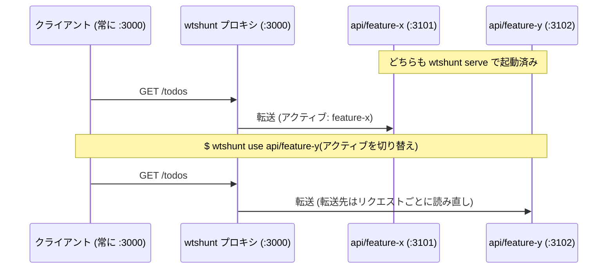

# wtshunt(worktree shunt)

[English](README.md)

git worktree でブランチを並行開発していても、そのサーバを見るクライアント(たとえばフロントエンドの dev サーバ)が叩くポートはひとつです。
worktree を切り替えるたびに、いま動いているサーバを止めて、別の worktree で立ち上げ直すことになります。
`wtshunt` はこの立て直しをなくすツールです。
worktree ごとにバックエンド(たとえば Rails アプリ)のサーバを別ポートで起動したままにします。
固定ポートで待ち受ける小さなリバースプロキシが、そのうち「アクティブ」な worktree にリクエストを転送します。
切り替えは次のリクエストから反映されます。
クライアントの再起動も `.env` の書き換えも `cd` も要りません。

shunt(入換)とは、操車場で全体の流れを止めることなく車両を別の線路へ振り分ける操作のことです。
wtshunt がトラフィックに対してやっているのは、まさにこれです。

direnv やシェルの alias のようなディレクトリ単位のツールが影響できるのは、これから起動するプロセスだけです。
すでに動いているクライアントの向き先は変えられません。
その「すでに動いているクライアントの向き先を変える」ことが、wtshunt の存在理由です。

- worktree のサーバをフォアグラウンドで起動: `wtshunt serve`
- worktree に `cd` せずに単発コマンドを実行: `wtshunt run`
- プロキシの向き先 worktree を切り替え: `wtshunt use`
- 全 worktree の稼働状況を一覧: `wtshunt status`

## これが不要な人

- git worktree をそもそも使っていないなら、出番はありません。
- クライアント側を気軽に再起動できる、あるいは接続先を env 変数や設定ファイルから読み直せる構成なら、そのポートを直接向ければ済みます。
- 同時に動かす worktree が常にひとつだけなら、従来通り `cd` して立ち上げ直すだけで十分です。

## 動作要件

- Node.js 20 以上(開発は Node 25 で実施)
- macOS または Linux(POSIX の `sh` とプロセスグループに依存し、ポート競合の診断に `lsof` を使います)
- `git`(worktree の列挙に `git worktree list` を使用)
- ピッカー([peco](https://github.com/peco/peco) / [fzf](https://github.com/junegunn/fzf))は任意。
  どちらかが `PATH` にあれば worktree の選択に自動で使われ、どちらも無ければ番号入力のプロンプトにフォールバックします

## インストール

```sh
npm install
npm link
```

`npm link` で `wtshunt` 実行ファイルが `PATH` に入ります([tsx](https://github.com/privatenumber/tsx) 経由で動くためビルドは不要です。`src/` を編集すれば即座に反映されます)。
リンクせずに試したい場合は、チェックアウトから直接 `./bin/wtshunt.js <command>` を実行できます。

## クイックスタート

```sh
# 1. バックエンドのリポジトリを登録(初回のみ。下の「設定」参照)
mkdir -p ~/.config/wtshunt && $EDITOR ~/.config/wtshunt/config.toml

# 2. worktree ごとにサーバを立ち上げておく(ターミナルのタブを分けてフォアグラウンドで)
wtshunt serve api/feature-x
wtshunt serve api/feature-y      # 別のタブで

# 3. 固定ポートにプロキシを立てる(さらに別のタブ、これもフォアグラウンド)
wtshunt proxy api

# 4. 固定ポートの向き先を好きなタイミングで切り替える
wtshunt use api                  # ピッカーが開き、次のリクエストから反映
```

同じ流れを図にすると、次のようになります。
2回目のリクエストは、何も再起動せずに feature-y に届きます:



この図は通常の HTTP リクエストの場合です。
WebSocket 接続は、開いたときに一度だけルーティングされます(「制約とトラブルシューティング」参照)。

プロキシは使うときだけ起動すれば十分です。
起動していないあいだは `fixed_port` を何も占有せず、他のコマンドはそれまで通りに動きます。

## 設定

設定ファイルは `$XDG_CONFIG_HOME/wtshunt/config.toml`(未設定なら `~/.config/wtshunt/config.toml`)です。
リポジトリごとに `[repos.<name>]` テーブルをひとつ定義します:

```toml
[repos.api]
path = "~/work/api"           # リポジトリ本体のチェックアウトのパス
fixed_port = 3000              # 他のサービスが常に叩くポート
port_range = [3101, 3199]      # 各 worktree に割り当てるポートの範囲
serve = "bundle exec rails s -p {port}"

[repos.front]
path = "~/work/front"
fixed_port = 8080
port_range = [8101, 8199]
serve = "API_URL=http://127.0.0.1:{api.port} PORT={port} npm run dev"
```

- `path` はリポジトリ本体のチェックアウトを指し、`~` 展開が使えます。
  wtshunt は worktree を作りません。
  `git worktree add` で自分で追加してください。
  `git worktree list` が返すもの(本体チェックアウトを含む)がすべて選択対象になります。
- `serve` は `sh -c` で実行され、`{port}` がその worktree に割り当てられたポートに置換されます。
  そのため `serve = "PORT={port} bin/dev"` のような環境変数プレフィックス形式も使えます。
  リテラルの `{port}` プレースホルダは必須で、含まれていない場合は設定の読み込み自体が失敗します。
  この検証が無ければ、サーバはフレームワークのデフォルトポートで起動する一方、`status` とプロキシは割り当てポートにいると思い込んだままになり、実態とズレてしまうためです。
- `serve` は `{<repo>.port}` で別の登録済みリポジトリのポートも参照できます。
  上の `front` のテンプレートは `{api.port}` を `api` のアクティブ worktree が使っているポートに解決し、まだ割り当てが無ければ新たに割り当てます。
  これが複数リポジトリの worktree を結びつける仕組みです。
  詳しくは下の「タスク (experimental)」を参照してください。
- 一度 `wtshunt serve` されたことのある worktree は、再起動しても同じポートを使い続けます(**sticky 割り当て**)。
  割り当て時にポートの占有を検知した場合のみ、`port_range` 内の次の空きポートが使われます。
  この占有チェックには限界もあります(「制約とトラブルシューティング」参照)。
- ポートの重複は設定の読み込み時にチェックされます。
  2つのリポジトリが同じ `fixed_port` を使うこと、`port_range` 同士が重なること、どのリポジトリの `fixed_port` もいずれかのリポジトリの `port_range`(自分自身の range も含む)に収まってしまうことは、いずれも即座にエラーになり、関係するリポジトリ名が示されます。

リポジトリごとに、任意で `[repos.<name>.https]` テーブルも設定できます。
mkcert(などの)証明書ですでに https 起動している worktree のサーバ向けの設定です:

```toml
[repos.api.https]
cert = "~/certs/localhost.pem"      # fixed_port をこの証明書で TLS 化
key = "~/certs/localhost-key.pem"
backend = true                       # worktree のサーバへの転送も https にする
```

- `cert`/`key` は固定ポートの受け口自体を TLS 化します。
  mkcert が発行した `localhost`/`127.0.0.1` 用の証明書は、そのまま指定できることがほとんどです。
  worktree のサーバがすでに信頼しているのと同じ証明書だからです。
  `cert` と `key` はセットで指定するか、両方省略するかのどちらかにしてください。
  どちらか一方のパスが存在しない、あるいは読み込めない場合は、設定の読み込み自体が即座に失敗します。
  パスは `path` と同じく `~` 展開に対応しています。
- `backend`(デフォルトは `false`)を `true` にすると、プロキシから worktree のサーバへの転送も https になります。
  バックエンド自体が TLS を終端している構成向けです。
  `cert`/`key` とは独立しており、http で受けて https に転送する構成も、https で受けて http に転送する構成も、自由に組み合わせられます。
- `[repos.<name>.https]` テーブル自体が無ければ、プロキシは従来通り http で受けて http で転送します。

`use` や `task add` の worktree 選択に使うピッカーは、`[picker]` テーブルで差し替えられます:

```toml
[picker]
command = "fzf --height 40% --reverse"
```

候補行を標準入力で受け取り、選択した行を標準出力に返すコマンドなら何でも使えます。
未指定の場合は peco、fzf の順に自動検出し、どちらも無ければ番号入力のプロンプトになります。

設定ファイルが無い場合、`wtshunt` は上と同じ2リポジトリ構成の例を表示して終了します。

## コマンド

ほとんどのコマンドは省略可能な `<repo>` または `<repo>/<worktree>` 引数を取ります。
`<repo>` だけならそのリポジトリの「アクティブ」な worktree が対象になります。
リポジトリ引数を省略した場合はカレントディレクトリから推測します(各リポジトリの本体チェックアウトと全 worktree に対して、シンボリックリンクを解決した上で照合します)。

### `wtshunt use [repo]`

リポジトリの「アクティブ」な worktree を選びます。
`repo/worktree` 形式なら直接セットします。
`repo` だけ(または cwd から推測)ならピッカーが開きます。
ピッカーは `[picker]` で設定したコマンド、無ければ自動検出した peco か fzf、どれも無ければ番号選択のプロンプトです(「設定」参照)。
プロキシが稼働中なら、切り替えた瞬間から新しいアクティブ worktree にルーティングされます。
再起動は不要です。
その worktree のサーバがまだ起動していなければ、`use` は警告を出して `wtshunt serve` の実行を促します。

### `wtshunt serve [repo]`

アクティブな(または指定した)worktree のサーバを、その worktree のディレクトリで、割り当てポートを使ってフォアグラウンドで起動します。
すでにサーバが動いている worktree への重複起動は拒否します。
`SIGINT`/`SIGTERM` は子プロセスグループに転送されるので、`Ctrl-C` できれいに止まります。

`wtshunt serve [repo] --direct` を付けると、`{port}` の置換値が通常の sticky ポートではなくリポジトリの `fixed_port` になります。
その worktree を、本番で bind されるのと同じ形でプロキシなしに動かすための、一時的な置き換えです。
sticky ポートの割り当ては一切変更しません。
リポジトリのプロキシがすでに稼働中なら拒否します(先に止めてください、そうしないと両方が `fixed_port` を取り合います)。
`fixed_port` をすでに他プロセスが占有している場合も拒否します(`wtshunt proxy` 自身の占有チェックと同じく `lsof` で表示します)。
起動したサーバのエントリは、`wtshunt status`/`wtshunt ui` にも通常のサーバと同じ形で表示され、ポートには `fixed_port` が記録されます。

### `wtshunt run [repo[/worktree]] <cmd...>`

worktree のディレクトリの中で任意のコマンドを実行します。
自分で `cd` する必要はありません。
たとえば `wtshunt run api bin/rails console`、そのリポジトリの中にいるなら単に `wtshunt run bin/rails console` と書けます。
内側のコマンドのフラグは一切加工されずに素通しされます(`run` については `wtshunt` はオプションパースを一切しません)。
`wtshunt run api bin/rails s -p 3105` は、手で実行したのと完全に同じように動きます。
対象 worktree がリポジトリの「アクティブ」な worktree から決まった場合(repo を省略した、または `/worktree` を付けずにリポジトリ名だけで指定した場合)、cwd がそのリポジトリの**別の** worktree の中にあると、`run` と `serve` は実行前に標準エラーへ1行警告を出します。
`repo/worktree` を明示的に指定すれば、その選択は意図的なものとみなされ警告は出ません。

### `wtshunt status`

設定済みの各リポジトリについて、アクティブな worktree、稼働中の全サーバ(worktree、ブランチ、ポート、pid)、プロキシの稼働状況と現在の転送先を表示します。
`{<repo>.port}` の結線が古くなっているサーバには `(stale wiring: api)` のように印が付きます(下の「タスク (experimental)」参照)。
worktree 自体が無くなったサーバには `(worktree gone)` の印が付き、その場合は末尾に `wtshunt prune` を促す一行が出ます。
`wtshunt status --json` は同じ内容を機械可読な JSON として出力します。
各サーバのエントリには同じ情報を持つ `staleWiring` 配列と `worktreeGone: true` フィールドも付きます(どちらも該当しなければ省略されます):

```sh
wtshunt status --json | jq '.repos[] | {name, active}'
```

定義済みのタスクも一覧します(下の「タスク (experimental)」を参照)。

### `wtshunt stop [repo]`

アクティブな(または指定した)worktree のサーバを停止します。
プロセスグループに `SIGTERM` を送った後、実際に終了したことを最大2秒ポーリングで確認してから、`wtshunt status` の一覧から取り除きます。
それでも生きていれば、エントリはそのまま残し、`stop` は警告付きで exit 1 になります(「制約とトラブルシューティング」参照)。

### `wtshunt proxy [repo]`

リポジトリの `fixed_port` でリバースプロキシをフォアグラウンド起動します。
停止は `Ctrl-C` です。
すべてのリクエストは、その時点でアクティブな worktree に転送されます。
転送先はリクエストごとにディスクから読み直されるため、`wtshunt use` は次の新規接続から反映され、プロキシは起動しっぱなしで構いません。
通常の HTTP レスポンス(エラーレスポンスを含む)には、処理した(あるいは処理に失敗した)worktree 名を示す `X-Wtshunt-Worktree` ヘッダが付きます。
唯一の例外は WebSocket のハンドシェイクです(「制約とトラブルシューティング」参照)。
アクティブな worktree のサーバが動いていなければ、プロキシは `502` と `wtshunt serve` を促すヒントを返します。
起動時に `fixed_port` が使用中なら、占有しているプロセスを(`lsof` で)表示して終了します。
WebSocket などの upgrade リクエストも転送します。
`use` との関係は「制約とトラブルシューティング」を参照してください。

### `wtshunt task ...`

experimental な複数リポジトリ向けプリセットです。
下の「タスク (experimental)」を参照してください。

### `wtshunt ui`

対話的なターミナル UI です。
`j`/`k` または矢印キーで各リポジトリの worktree(と定義済みのタスク)の一覧を移動し、画面を離れずに選択中の行に対して操作できます:

- **`u`**：worktree の行ならそのアクティブ worktree をセットします。
  タスクの行ならそのタスクを適用します。
  repo の行では何もしません。
- **Enter**：選択中の行を on/off でトグルします。
  worktree の行では、サーバが稼働中なら停止、していなければ起動します。
  repo の行では、`p` と同じくプロキシをトグルします。
  タスクの行では、`u` と同じくそのタスクを適用します(タスクの行に on/off の状態はありません)。
- **`s`**：選択中の worktree のサーバを起動します。
- **`d`**：同じですが `--direct` 付きです(上の `wtshunt serve --direct` を参照)。
  本番と同じ形でプロキシなしに触ってみたいときに使います。
- **`x`**：停止します。
- **`r`**：再起動します(停止してから起動。停止がタイムアウトした場合は起動しません)。
- **`p`**：その行のリポジトリのプロキシをトグルします。稼働中なら停止、停止中なら起動します。
- **`q` / `Ctrl-C`**：終了します。

各行の先頭の印は、稼働中なら `●`、停止中なら `○` です。
サーバやプロキシを起動した直後(`s`、`d`、`r`、`p`、または Enter の起動側)は、代わりに `◐` になります。
次の自動更新で実際に稼働を確認できれば `●` に変わり、15秒経っても確認できなければ `○` に戻ります(起動失敗はペイン自体に表示されるので、`wtshunt ui` は理由を推測せずただ待つのをやめるだけです)。

worktree 自体が無くなったサーバにも行が表示されます(`(worktree gone)` の印付き)。
`wtshunt prune` を別途実行しなくても、その場で `x` を押して停止できます。

画面は数秒おきに自動更新され、各操作の直後にも更新されます。
`serve`/`proxy` は常に UI 自身とは別のプロセスとして、別のペイン、タブ、ウィンドウで開かれます。
どのマルチプレクサで開くかは「`wtshunt ui` からのペインの開き方」を参照してください。
対話的なターミナル(TTY)が必要です。

### `wtshunt whoami`

カレントディレクトリがどのリポジトリのどの worktree に属しているかを1行で報告します。
シェルのプロンプトへの埋め込みや、エージェントが自分の作業場所を確認する用途を想定しています。
例: `api/feature-x port 3101 (running, active)`。
その worktree が一度も serve されていなければポート部分は省略されます。
そのリポジトリの現在のアクティブ worktree でなければ `, active` は付きません。
`--json` を付けると詳細情報(ブランチ、パス、稼働中サーバ、プロキシの転送先)を出力します。
カレントディレクトリが登録済みリポジトリのどれにも属していなければエラーになり、exit 1 で終了します。
プロンプトに埋め込む場合は `2>/dev/null` を付けて黙らせられます。

Tip: `wtshunt whoami 2>/dev/null` はそのまま `PS1` に埋め込めます。

### `wtshunt prune [repo]`

もう存在しない worktree(`git worktree remove` で消した、あるいは手動で削除した)が残した state を掃除します。
`state.json` を実際の `git worktree list` の結果と突き合わせ、対象は指定した1リポジトリ、省略時は全リポジトリです。
消えた worktree について次を行います。
稼働中のサーバがあれば(`wtshunt stop` と同じ、`SIGTERM` を送って終了をポーリングする手順で)停止してからエントリを削除します。
sticky なポート割り当てを削除します。
リポジトリの `active` ポインタがその worktree を指していればクリアします。
その worktree をメンバーに持つタスクがあれば、そのメンバーだけを外します(空になったタスクは削除します)。
`--dry-run`(`-n`)を付けると、何も変更せずに変更予定の内容だけを表示します。
掃除するものが無ければ `Nothing to prune.` の一行だけ表示します。

### `wtshunt doctor`

読み取り専用の診断レポートです。
プレーンテキストなので、Slack などにそのまま貼り付けられます。
wtshunt 自身のバージョン(commit hash 付き)、Node と platform、設定が読み込めるかと各リポジトリのパス・git リポジトリかどうか・worktree 数、各 `fixed_port` と sticky ポートについて実際の `lsof` の LISTEN 状況が `state.json` の想定と一致しているか、`wtshunt prune` が掃除するはずの stale なエントリの有無、自動検出されるピッカーとマルチプレクサを出力します。
設定が壊れていてもクラッシュせず、その事実自体を診断結果として報告します。
何か問題があれば exit 1、無ければ exit 0 になるため、スクリプトからの簡易ヘルスチェックにも使えます。

### `wtshunt help [command]`

`wtshunt --help` と同じ内容を表示します。
コマンド名を付けると、そのコマンド自体のヘルプ(`wtshunt <command> --help` 相当)を表示します。

## 制約とトラブルシューティング

まず `wtshunt doctor` を実行してください。
設定・ポート・state を読み取り専用でひと通り確認するだけで、下記のほとんどの原因が分かります。

- **WebSocket は接続時にルーティングされ、切り替え時には動かない。**
  upgrade リクエスト(Rails ActionCable、Vite/webpack の HMR)は、接続が開かれた時点でアクティブな worktree に転送されます。
  確立済みの接続は `use` で切り替えても移動せず、次の新規接続から新しい worktree に反映されます。
  実際には ActionCable や HMR のクライアントは自分で再接続するため、再接続した瞬間に新しい worktree に繋がり、ほとんど気になりません。
  101 のハンドシェイクレスポンスはそのまま中継されるため、通常の HTTP レスポンスと違い `X-Wtshunt-Worktree` ヘッダは付きません。
- **`status` が報告するのはプロセスの生存であって、疎通ではない。**
  想定と違うポートやインターフェースに bind してしまったサーバは、稼働中と表示されたままプロキシは 502 を返します。
  `status` と現実が食い違うときは、`lsof -i :<port>` で実際に listen しているプロセスを確認してください。
- **ポートの空きチェックはすり抜けられることがある。**
  空きの確認は IPv4/IPv6 のワイルドカードアドレスへの bind で行うため、インターフェースを問わず他プロセスを検知できます。
  それでも、チェックの直後、新しいサーバが bind するまでのわずかな時間差は残ります。
  この間に sticky ポートを他プロセスに奪われると、新しいサーバは `EADDRINUSE` で即死することがあります。
  `wtshunt serve` の直後に数秒以内でサーバが落ちる場合、表示されるヒントが「割り当てポートが(`lsof` によれば)他プロセスに握られている」のか「定番の `.env` / `node_modules` の未コピーらしい」のかを教えてくれます。
- **`stop` は最大2秒待ってから諦める。**
  `SIGTERM` を送った後、実際にプロセスが終了するまでポーリングします。
  2秒経っても生きていれば(`SIGTERM` をトラップしている、あるいは単に終了処理が遅い)、あえて `wtshunt status` の一覧に残したままにします。
  `stop` は成功したふりをせず、警告付きで exit 1 になります。
- **worktree 間で開発用データベースを共有しがち。**
  マイグレーションが分岐したブランチ同士を同じデータベースに向けて動かすと、どちらかが壊れ得ます。
  頻繁に切り替えるなら worktree ごとのデータベース名を検討してください。
- **転送先の TLS 証明書は検証しない。**
  `[repos.<name>.https].backend = true` にすると、worktree のサーバへのリクエストは https で送られますが、証明書の検証はあえて省いています。
  mkcert のローカル CA は Node の信頼ストアに入っておらず、この通信は loopback に閉じた開発用途なので、検証の手間に見合わないためです。
- **`serve` テンプレートの `{<repo>.port}` を使う URL のスキーム(`http://` か `https://`)は設定側の責任。**
  wtshunt が置換するのはポート番号だけです。
  `API_URL=http://127.0.0.1:{api.port}` を `https://` にすべきかどうかは `api` 自身の `[repos.api.https]` の設定次第で、wtshunt 側で検証することはできません。

## シェル補完

`wtshunt completion` は、実行しているシェルに合わせた補完スクリプトを出力します。
補完候補は `<Tab>` のたびに動的に計算されるため、リポジトリや worktree を後から追加しても、再インストールなしで即座に補完されます:

- 何も入力していない状態では、コマンド名(`use`、`serve`、`run`、`status`、`stop`、`proxy`、`task`、`ui`、`whoami`、`prune`、`doctor`、`help`、`completion`)を提案します。
- `use`、`serve`、`stop`、`proxy`、`run` の第1引数では、すべてのリポジトリ名と `repo/worktree` 名を提案します。
  `run <Tab>` で全候補が並び、`run api/<Tab>` で `api` の worktree に絞り込まれます。
  `prune` の第1引数では、リポジトリ名のみを提案します(prune はリポジトリ単位が対象なので `repo/worktree` の形式は出しません)。
  `help` の引数ではコマンド名を提案します。
- `task` の後は `add`/`use`/`list`/`rm` を、`task use` や `task rm` の後は定義済みのタスク名を提案します。
  `task add <name>` の後は、`run` などと同じ repo/worktree の候補にフォールバックします。
- それ以外の位置では、意図的に候補を返しません。
  どのリポジトリにも worktree にも前方一致しない語(例: `run rails<Tab>`)や、どのコマンドでも第2引数以降(例: `run api bin/<Tab>`)がこれに当たります。
  候補が空ならシェルは通常のファイル/コマンド補完にフォールバックするので、決して当てはまらない worktree 名を提案し続けることがなくなります。

zsh:

```sh
wtshunt completion >> ~/.zshrc
```

bash:

```sh
wtshunt completion >> ~/.bashrc
```

新しいシェルを開く(か rc ファイルを `source` する)と有効になります。
rc ファイルに追記されるのは「どのコマンド名が存在するか」という静的なスクリプトだけで、リポジトリと worktree の候補は `<Tab>` のたびに計算し直されます。

zsh 用スクリプトは zsh の補完システムを自前で初期化します(`compdef` が未定義なら `compinit` を呼びます)。
そのため、`compinit` を一度も呼ばない `.zshrc` でもそのまま動きます。

## `wtshunt ui` からのペインの開き方

`wtshunt ui` が行に対して `serve`/`proxy` を開くとき(`s`/`d`/`r`/`p`、または Enter の起動側)、常に別のペイン、タブ、ウィンドウの中でフォアグラウンドプロセスとして起動します。
手元で `wtshunt serve` や `wtshunt proxy` を実行するのと同じ種類のプロセスを、代わりに起動してくれるだけです。
開き方は次の順番で決まります:

1. `config.toml` に `[ui]` セクションがあれば、それが常に優先されます:

   ```toml
   [ui]
   open = "my-launcher --name {title} {cmd}"
   ```

   `{title}`、`{cmd}`、`{cwd}` が(それぞれ安全にシェルクォートされた上で)置換され、その結果が `sh -c` で実行されます。
   そのため、「ラベル付きの新しいペインで指定コマンドを実行できる」CLI を持つマルチプレクサやランチャーであれば何でも指定できます。
2. それが無ければ、[herdr](https://herdr.dev) が検出された場合はそれを使います(`HERDR_ENV`/`HERDR_SOCKET_PATH` 環境変数が設定されている場合)。
   ペインは `wtshunt ui` のリストの並び順に合わせて左から右へ配置され、実際に開いた順番には左右されません。
   たとえば3行目を1行目より先に開いても、1行目のペインは3行目のペインより左に挿入されます。
3. それも無ければ、[cmux](https://cmux.app) が検出された場合はそれを使います(`CMUX_SOCKET_PATH`/`CMUX_WORKSPACE_ID` が設定されていて `cmux` が `$PATH` にある場合)。
   フォーカスを奪わずに新しい workspace を開きます。
4. それも無ければ、[tmux](https://github.com/tmux/tmux) が検出された場合はそれを使います(`$TMUX` が設定されている場合)。
   現在のセッションに新しいウィンドウを追加します。
5. どれも無ければ、`wtshunt ui` は何も開かず、代わりに手元の別ターミナルで実行すべきコマンドを表示します。

いずれの場合も、実行されるコマンドは常に wtshunt 自身の解決済み実行ファイルパスを直接参照します。
新しいペインで `$PATH` が同じように設定されているとは限らないため、単に `wtshunt` と書く呼び出しには依存しません。

## herdr プラグイン

このリポジトリは [herdr](https://herdr.dev) のプラグイン(`herdr-plugin.toml`)を兼ねています。
herdr 上なら、どのペインからでも `wtshunt ui` を一時的なオーバーレイとして呼び出せます。
worktree を切り替えて `q` で閉じれば、フォーカスは元のペインに戻ります。

```sh
herdr plugin install meganemura/wtshunt  # GitHub から(npm install も実行されます)
herdr plugin link /path/to/wtshunt       # ローカルのチェックアウトから(npm install は自分で)
```

これで `wtshunt.ui` というアクションが登録されます。
まず `herdr plugin action invoke wtshunt.ui` で一度動きを確かめ、herdr 側の `config.toml` でキーに割り当ててください。

```toml
[[keys.command]]
key = "prefix+w"
type = "plugin_action"
command = "wtshunt.ui"
description = "wtshunt ui"
```

このオーバーレイから `serve`/`proxy` を開いても、作業中だったタブは分割されません。
同じワークスペース内の専用の `wtshunt` タブに集約され、そのタブは初めて必要になったタイミングで作成されます。
そのタブは上段に `wtshunt ui` 自身が常駐し、下段に `serve`/`proxy` のペインがリストの並び順で横に並びます。
サーバが全部止まってもタブごと消えることはなく、そのタブ内の `wtshunt ui` からもサーバを操作できます。
タブ内の `wtshunt ui` から `s`/`d`/`p` を押して開いた場合も、同じ下段に並びます。

## タスク (experimental)

タスクは wtshunt の発展的な複数リポジトリ向けレイヤーで、ここまでの機能はタスク無しで完結します。
この機能は experimental であり、実際の使用感のフィードバックによって挙動が変わる可能性があります。

変更が複数リポジトリにまたがるようになると、単一リポジトリの worktree だけでは足りません。
たとえば `api` のあるブランチと、それを呼ぶ `front` のブランチのような組み合わせです。
**タスク**はリポジトリごとにひとつの worktree を束ねた名前付きプリセットで、グループ全体をまとめて切り替えられます:

```sh
wtshunt task add feature-x api/feature-x front/feature-x
wtshunt task use feature-x
```

- `wtshunt task add <name> [repo/worktree ...]` はタスクを作成します。
  明示的に指定したリポジトリはその worktree を使い、指定しなかった登録済みリポジトリはそれぞれについてピッカーで選択を促されます(先頭に「このリポジトリをタスクに含めない」選択肢があります)。
- `wtshunt task use <name>` はまず全メンバーの worktree がまだ存在するか検証し、ひとつでも欠けていれば何も適用せずエラーにします。
  検証後、全メンバーを一括で切り替え、どのメンバーがまだ `wtshunt serve` されていないかを報告し、起動中のサーバの `{<repo>.port}` の結線が古くなっていないかも警告します(下記参照)。
- `wtshunt task list` はタスクとそのメンバーを一覧し、全メンバーが現在のアクティブ worktree と一致するタスクには `*` を付けます。
- `wtshunt task rm <name>` はタスクを削除します。

### 結線の仕組み

では、`front` と `api` の結線はどう保たれるのでしょうか。
サービスの手前に立つ固定ポートのプロキシは、稼働状況を記録したファイル(`state.json`)をリクエストごとに読み直します。
その部分は常に現在アクティブな worktree を反映するので、再起動は不要です。

一方、`serve` テンプレートの `{<repo>.port}` 参照は違います。
これはサーバ起動時に実行される具体的なシェルコマンドへ一度だけ置換されるため、そのプロセスが動き続けている限り固定されたままです。
`api` のアクティブ worktree を切り替えても、すでに動いている `front` のプロセスの接続先は自動的には変わらず、再起動するまで `api` の古いポートを叩き続けます。
`task use` がチェックしているのは、まさにこの状態です。
`{<repo>.port}` の結線がもう一致しないサーバが動いていれば、`wtshunt stop <repo> && wtshunt serve <repo>` で結線し直すよう警告します。
まだ一度も動いていない worktree は、初めて `serve` したときに自動的に正しい結線になります。

`front` にコミット済みの `.env` があり、そこに `API_URL` が定義されているとしましょう。
この場合でも `serve` テンプレートの `API_URL={api.port}` が優先されるのは、フレームワークの `.env` ローダーが「既に設定済みの環境変数は上書きしない」実装であるときだけです。
ほとんどの dotenv 実装ではそれがデフォルト挙動ですが、自分のスタックで一度確認しておく価値はあります。

プロキシの host:port は切り替えても変わらないため、クライアントが持っている Cookie はそのまま引き継がれます。
それが表すセッションが有効なままかどうかは、関係する worktree 同士がセッションストアを共有しているかどうか次第です。
上の「制約とトラブルシューティング」にある開発用データベース共有の注記を参照してください。

## 開発

```sh
npm install
npm test        # node:test。テストが実際の設定や state に触れることはありません
```

ビルドステップはありません。
CLI は tsx 経由で `src/` の TypeScript を直接実行します。
`src/commands/*.ts` が各サブコマンドのハンドラで、`src/proxy.ts` がリバースプロキシの実装本体です(`src/commands/proxy.ts` はその薄い CLI ラッパー)。
`src/portRefs.ts` が `{<repo>.port}` の解決、`src/tasks.ts` が結線ズレ検知とタスクの一致判定ロジック、`src/picker.ts` が `use` と `task add` で共有するピッカー(`[picker]` の設定、無ければ peco/fzf の自動検出、それも無ければ番号選択)です。
`src/overview.ts` が `status`/`status --json` 双方の元データを集約します。
`src/mux.ts` が `wtshunt ui` の `serve`/`proxy` 起動に使うマルチプレクサアダプタの実装、`src/ui/` が `wtshunt ui` の行モデル、キー処理、描画のロジックです(`src/commands/ui.ts` はその薄いターミナル/イベントループラッパー)。
`src/prune.ts` はもう存在しない worktree が残した state エントリの検出ロジックで、`wtshunt prune`、`wtshunt doctor` の state セクション、`status`/`ui` の `(worktree gone)` 印で共有しています。
実行時の state は `$XDG_STATE_HOME/wtshunt/state.json`(デフォルトは `~/.local/state/wtshunt/state.json`)に置かれます。

## ライセンス

MIT です。
[LICENSE](LICENSE) を参照してください。
