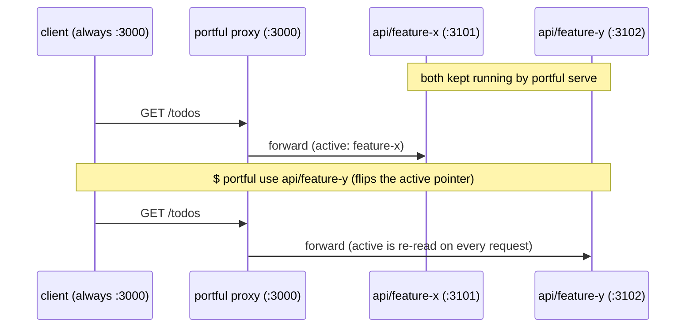

# portful

[](https://www.npmjs.com/package/portful)

Git worktrees let you develop several branches in parallel, but the
client that talks to your server (say, a frontend dev server) still hits
a single port, so every switch means stopping the running server and
starting it again from another worktree. `portful` removes that
restart: each worktree keeps its own backend server (say, a Rails app)
warm on its own port, and a small reverse proxy on the fixed port
forwards to whichever worktree is currently "active." Switching takes
effect on the very next request: no restarting the client, no editing
`.env`, no `cd`.

The name answers [portless](https://portless.sh/), which replaces port
numbers with named `.localhost` URLs. Ports are the subject here. One
port stays fixed for every client, and one more port runs behind it for
each worktree. portful borrows portless's commands and config layout
wherever the two tools do the same thing, so a portless user can read
this one without a second manual. See
[Coming from portless](#coming-from-portless).

Directory-scoped tools like direnv or shell aliases only affect processes
you start *afterwards*. They cannot re-point a client that is already
running. Redirecting that already-running client is the case portful
exists for.

- Start this worktree's server: `portful` (or `portful run`)
- Start a named worktree's server: `portful serve api/feature-x`
- Flip which worktree the proxy points at: `portful use`
- See where each fixed port currently goes: `portful list`
- Run one-off commands inside a worktree without `cd`-ing there: `portful exec`

## When you don't need this

- You're not using git worktrees at all, so there's nothing here for you.
- Your client can be restarted cheaply, or already re-reads its target
  from an env var/config file. Just point it at the new port directly.
- You only ever run one worktree's server at a time: plain `cd` and
  start/stop already does the job.

## Coming from portless

[portless](https://github.com/vercel-labs/portless) gives each app a
named `.localhost` URL and routes to it by hostname. portful keeps one
fixed port per repo and routes by which worktree is active, re-read on
every request. The two answer different questions, so many people want
both: point a portless alias at portful's fixed port, and the name comes
from portless while the switching comes from portful.

Commands that mean the same thing carry the same name:

| portless | portful |
| --- | --- |
| `portless` | `portful` |
| `portless run` | `portful run` |
| `portless <name> <cmd...>` | `portful <repo> <cmd...>` |
| `portless list` | `portful list` |
| `portless proxy start` / `stop` | `portful proxy start` / `stop` |
| `portless doctor` | `portful doctor` |
| `portless prune` | `portful prune` |
| `portless clean` | `portful clean` |
| `portless trust` | portful uses the certificates that you configure for its proxy |
| `portless hosts sync` / `hosts clean` | portful routes through its configured fixed ports |
| `portless service install` | run `portful proxy start` in a terminal for each proxy |
| `portless proxy start --lan` / `--tailscale` / `--ngrok` | portful binds the loopback addresses only |
| `portless alias <name> <port>` | `portful use <repo>/<worktree>` selects a worktree by name |
| change each portless alias for a multi-repo context | `portful task add` / `task use` stores and selects that context |
| change to the worktree directory and run the command | `portful exec <repo>/<worktree> <cmd...>` |
| use the portless commands for each operation | `portful ui` provides an interactive terminal interface |
| identify the current app from the directory and `portless list` | `portful whoami` reports the current repo and worktree |
| run the app outside portless, on whatever port it binds | `portful serve --direct` binds the fixed port for one run, with no proxy in front |

The extra portless commands install or update machine resources, such as a CA,
host entries, a service, or network exposure. On the portful side, the extra commands pick
the worktree or the multi-repo context to use now, and act inside it.

Config follows the same layout: a `portful.json` in the repo, or a
`"portful"` key in `package.json`, with the same precedence portless
uses. `PORT`, `HOST`, and `PORTFUL_URL` reach the child process, so a
server that already reads `PORT` starts with no template at all.

Four things stay different, deliberately:

- **The address is a port, not a name.** That is the whole point: a
  client that already holds `http://127.0.0.1:3000` keeps working across
  a switch, cookies included.
- **No privileged port, no CA, no `/etc/hosts`.** portful writes to its
  own config and state directories and binds the ports you configure. A
  managed work laptop can run it without an administrator.
- **`proxy start` runs in the foreground.** One tab per proxy keeps the
  request log visible and makes `Ctrl-C` the stop button.
- **`alias` is absent.** In portless it adds another hostname route; here
  it would have to mean "ignore the active worktree", which is a
  different action. `portful <repo> <cmd...>` covers reaching a server
  portful did not start.

Both tools can switch a client to another worktree while its URL and cookies
stay unchanged. With portless, run `portless list`, copy the assigned port from
the 4000-4999 range, then run `portless alias <name> <port> --force`. With
portful, `portful use` accepts the worktree name and resolves its port internally.

## Requirements

- Node.js 24 or newer (developed on Node 26)
- macOS or Linux, since portful relies on POSIX `sh` and process groups,
  and uses `lsof` to diagnose port conflicts
- `git` (worktrees are enumerated with `git worktree list`)
- A picker ([peco](https://github.com/peco/peco) or
  [fzf](https://github.com/junegunn/fzf)) is optional; whichever is on
  your `PATH` is used for worktree selection, with a numbered prompt as
  the fallback

## Install

```sh
npm install -g portful
```

The published package is a single bundled file with no dependencies of
its own, so the install adds one package and nothing else.

To work on portful from a checkout instead:

```sh
git clone https://github.com/meganemura/portful.git
cd portful
npm install
./bin/portful.js <command>
```

That entry point runs the TypeScript in `src/` through
[tsx](https://github.com/privatenumber/tsx), so an edit takes effect on
the next command with no build in between. `npm link` puts it on your
`PATH` under the name `portful`.

## Quick start

```sh
# 1. Register the repo, once per machine: which repos exist and where they are
mkdir -p ~/.config/portful
cat > ~/.config/portful/config.json <<'JSON'
{ "repos": { "api": { "path": "~/work/api" } } }
JSON

# 2. Give the repo its ports. This file lives in the checkout, so committing
#    it hands the same setup to every contributor.
cat > ~/work/api/portful.json <<'JSON'
{
  "fixedPort": 3000,
  "portRange": [3101, 3199],
  "serve": "bundle exec rails s -p {port}"
}
JSON

# 3. Warm one server per worktree: one terminal tab each, in the foreground
portful serve api/feature-x
portful serve api/feature-y      # in another tab

# 4. Put the proxy on the fixed port (another tab, also foreground)
portful proxy start api

# 5. Flip the fixed port between worktrees at will
portful use api                  # opens the picker; applies on the next request
```

A server that reads the `PORT` environment variable needs no `serve` line
at all. Drop it, and `portful` run from inside a worktree starts that
project's own `dev` script with `PORT` already set.

The same flow as a diagram (the second request lands on feature-y
without anything being restarted):



The diagram shows ordinary HTTP requests; a WebSocket connection is
routed once, when it is opened (see Limitations).

The proxy is opt-in: when it isn't running, nothing occupies
`fixedPort`, and every other command keeps working the same way.

## Configuration

Config lives at two levels, the way portless splits its own.

**The user-level file** is `$XDG_CONFIG_HOME/portful/config.json`,
falling back to `~/.config/portful/config.json`. It registers which repos
exist and where their checkouts are, which no file inside a repo can
state about itself:

```json
{
  "repos": {
    "api":   { "path": "~/work/api" },
    "front": { "path": "~/work/front" }
  },
  "picker": { "command": "fzf --height 40% --reverse" }
}
```

**The repo-level file** is `portful.json` at the repo's main checkout, or
a `"portful"` key in its `package.json`. It carries what belongs to the
project:

```json
{
  "fixedPort": 3000,
  "portRange": [3101, 3199],
  "serve": "bundle exec rails s -p {port}"
}
```

Precedence is one rule: the user-level entry wins over both repo-level
sources, and the `package.json` key wins over `portful.json`, matching
portless. Your machine beats the repo's suggestion, because ports are
allocated per machine.

### Keys

- `path` (user level only) points at the repo's main checkout and
  supports `~` expansion. portful does not create worktrees. Add them
  yourself with `git worktree add`; everything `git worktree list`
  reports (including the main checkout) becomes selectable.
- `fixedPort` is the port other services always talk to.
- `portRange` is `[min, max]`, the ports handed out to individual
  worktrees.
- `serve` is optional. When set, it is run with `sh -c`, with `{port}`
  substituted for the port assigned to that worktree, so env-var prefixes
  work too (`"serve": "PORT={port} bin/dev"`). A `serve` that is set must
  contain the literal `{port}`: without it the server binds whatever port
  your framework defaults to, while `status` and the proxy keep believing
  it is on the assigned one.
- `script` names the `package.json` script to run when `serve` is absent,
  defaulting to `dev`. The package manager comes from the lockfile in the
  worktree: `pnpm-lock.yaml`, `yarn.lock`, `bun.lockb`, then
  `package-lock.json`, falling back to npm.
- `serve` can also reference another registered repo's port with
  `{<repo>.port}`. A `front` template of
  `"API_URL=http://127.0.0.1:{api.port} PORT={port} npm run dev"` resolves
  `{api.port}` to whatever port `api`'s active worktree is using,
  allocating one if it doesn't have one yet. This is what lets multiple
  repos' worktrees stay wired together; see Tasks below for the full
  workflow.
- `name`, if you set it in `portful.json`, must match the name the repo
  is registered under. A mismatch fails config loading, naming both.

Every server portful starts receives `PORT`, `HOST`, and `PORTFUL_URL`
in its environment. `PORTFUL_URL` is the fixed-port address clients use,
not the worktree's own port.

Each worktree that ever gets a `portful serve` keeps the same port across
restarts (a "sticky" assignment), unless portful finds the port occupied
at assignment time, in which case the next free port in `portRange` is
used. The occupancy check has limits (see Limitations).

Ports are checked for collisions across repos when the config loads: two
repos can't share a `fixedPort`, their `portRange`s can't overlap, and no
repo's `fixedPort` may fall inside any repo's `portRange` (including its
own). Each of these fails config loading immediately, naming the repos
involved.

### https

A repo can carry an optional `https` object, for worktree servers that
already run with a mkcert (or similar) certificate:

```json
{
  "fixedPort": 3000,
  "portRange": [3101, 3199],
  "https": {
    "cert": "~/certs/localhost.pem",
    "key": "~/certs/localhost-key.pem",
    "backend": true
  }
}
```

- `cert`/`key` TLS-terminate the fixed-port listener itself. A mkcert-issued
  pair for `localhost`/`127.0.0.1` can usually be pointed at directly, since
  it's the same certificate the worktree servers already trust. They must be
  set together, or both left out entirely; either path not existing or not
  being readable fails config loading immediately, and both paths support
  `~` expansion the same way `path` does.
- `backend` (default `false`) makes the proxy talk to the worktree's own
  server over https instead of http, for setups where the backend itself
  terminates TLS. It's independent of `cert`/`key`: a plain-http listener
  can forward to an https backend, and a TLS-terminating listener can
  forward to a plain-http backend, in any combination.
- With no `https` object at all, the proxy stays plain http in, plain
  http out.

portful generates no certificate authority and touches no system trust
store. Point it at a pair you already have.

### Picker

The picker `use` and `task add` open for worktree selection comes from
the user-level `picker` object shown above. Any command that reads
candidate lines from stdin and prints the selected line to stdout works.
When unset, peco and then fzf are auto-detected, falling back to a plain
numbered prompt.

If the config file is missing, `portful` prints a sample and exits.

## Commands

Most commands take an optional `<repo>` or `<repo>/<worktree>` argument.
`<repo>` alone uses the repo's current "active" worktree; a bare
invocation with no repo tries to infer the repo from your current
directory (matching it against each configured repo's main checkout and
all of its worktrees, symlinks included).

### `portful` and `portful run`

Starts a server for the worktree you are standing in. This is the
portless-shaped entry point: `portful` on its own is the same as
`portful run`, and `portful run --name <repo>` names the repo instead of
inferring it.

What it runs, in order: the repo's `serve` template when one is set,
otherwise the `package.json` script named by `script` (default `dev`),
run through the package manager the worktree's lockfile indicates. A
script that the project does not define is reported along with the
scripts it does define.

`run` takes the worktree from the current directory. `serve` follows the
repo's active pointer instead, which is the pointer this tool exists to
switch, so the two verbs answer two different questions.

### `portful <repo> <cmd...>`

Starts a server for `<repo>` running the command you give, replacing the
`serve` template, the way `portless <name> <cmd...>` starts an app:

```sh
portful api bundle exec rails s
portful api/feature-x npm run dev
```

The worktree comes from the current directory, or from the active
pointer when you are standing outside the repo. The command is spawned
directly rather than through a shell, so its arguments reach it exactly
as typed, and it reads its port from `PORT`.

Every command name listed in this section is reserved, so a repo named
`status` or `list` needs `portful serve status` rather than the
positional form.

### `portful use [repo]`

Pick which worktree of a repo is "active." With `repo/worktree`, sets it
directly. With just `repo` (or nothing, inferred from cwd), opens a
picker: the `picker` command from config if set, otherwise
auto-detected peco or fzf, otherwise a plain numbered prompt (see
Configuration). If the proxy is already running, it
immediately starts routing to the newly active worktree, no restart
needed. If no server is running yet for that worktree, `use` warns you
and tells you to run `portful serve`.

### `portful serve [repo]`

Starts the backend server for the active (or given) worktree in the
foreground, in that worktree's directory, on an assigned port. Refuses to
start a second server for a worktree that already has one running.
Forwards `SIGINT`/`SIGTERM` to the child process group, so `Ctrl-C` stops
it cleanly.

`portful serve [repo] --direct` substitutes the repo's `fixedPort` for
`{port}` instead of the usual sticky worktree port, for running that
worktree exactly as it'd look bound in production, no proxy in front of
it. It's a one-off, temporary substitution: the sticky ports map is left
completely untouched. Refuses to start if the repo's proxy is already
running (stop it first, since otherwise both would fight over `fixedPort`),
or if something else already occupies `fixedPort` (reported via `lsof`,
the same way `portful proxy start`'s own occupied-port check does). The
resulting server entry in `portful status`/`portful ui` shows `fixedPort`
as its port, same as any other running server.

### `portful exec [repo[/worktree]] <cmd...>`

Runs an arbitrary command inside a worktree's directory, without `cd`-ing
there yourself, e.g. `portful exec api bin/rails console` or, from
inside that repo already, just `portful exec bin/rails console`. Flags on
the inner command are passed through completely untouched (`portful`
does no option parsing at all for `exec`), so
`portful exec api bin/rails s -p 3105` works exactly as if you'd run it
by hand. If the target worktree comes from the repo's active pointer
(repo omitted, or given bare with no `/worktree`) and your cwd is
actually inside a *different* worktree of that repo, both `exec` and
`serve` print a one-line warning to stderr before running. Passing
`repo/worktree` explicitly always suppresses it, since that's you
choosing on purpose.

The name is `exec` rather than `run` because portless's `run` already
means "start the app through the proxy", and portful's `run` means the
same thing. `docker exec` and `kubectl exec` use `exec` for this action.

### `portful status`

Shows, for every configured repo: the active worktree, every running
server (worktree, branch, port, pid), and whether the proxy is running
and what it's currently routing to. A server whose `{<repo>.port}`
wiring has gone stale (see Tasks below) is marked inline, e.g.
`(stale wiring: api)`, and one whose worktree no longer exists is marked
`(worktree gone)`, with a reminder at the bottom to run `portful prune`
when that happens. `portful status --json` prints the same data as
machine-readable JSON instead: each server entry also gets a
`staleWiring` array and a `worktreeGone: true` field with the same
information (both omitted when they don't apply), e.g.:

```sh
portful status --json | jq '.repos[] | {name, active}'
```

It also lists any defined tasks (see
[Tasks (experimental)](#tasks-experimental) below).

### `portful list`

One row per repo: the address clients use, the worktree it currently
reaches, and whether the proxy is up. This is portless's `list`, and it
answers the one question that command answers: where does each route go
right now.

```
NAME   ADDRESS                TARGET             PROXY
api    http://127.0.0.1:3000  feature-x :3101    running
front  http://127.0.0.1:8080  main (no server)   stopped
```

`--json` prints the same rows as machine-readable JSON. `status` stays
the fuller per-repo view.

### `portful stop [repo]`

Stops the running server for the active (or given) worktree: sends
`SIGTERM` to its process group, then polls for up to 2 seconds to
confirm it actually exited before removing it from `portful status`. If
it's still alive after that, the entry is left in place and `stop` exits
`1` with a warning (see Limitations).

### `portful proxy start [repo]`

Starts the reverse proxy on the repo's `fixedPort`, in the foreground;
stop it with `Ctrl-C`. Every request is forwarded to whatever worktree is
currently active, re-read from disk on every request, so `portful use`
takes effect on the very next new connection, with the proxy left
running. Ordinary HTTP responses (including error responses) carry an
`X-Portful-Worktree` header naming the worktree that handled (or failed
to handle) the request. The WebSocket handshake response is the one
exception (see Limitations). If the active worktree has no server running,
the proxy returns `502` with a hint to run `portful serve`. If
`fixedPort` is already in use when starting, it prints the process
occupying it (via `lsof`) and exits. WebSocket and other Upgrade
requests are forwarded too (see Limitations for how that interacts
with `use`).

The foreground is deliberate, where portless runs a daemon: one tab per
proxy keeps the request log visible and makes `Ctrl-C` the stop button.
There is no `--foreground` flag, because a flag by that name would imply
a background default that does not exist.

### `portful proxy stop [repo]`

Stops a proxy started in another terminal: sends `SIGTERM` to it and
polls for up to 2 seconds to confirm it exited, the same way `stop` does
for a worktree server. Says so plainly, and exits 0, when no proxy is
running for that repo.

### `portful task ...`

Experimental multi-repo presets: see
[Tasks (experimental)](#tasks-experimental) below.

### `portful ui`

An interactive terminal UI: navigate every repo's worktrees (and any
defined tasks) with `j`/`k` or the arrow keys, and act on the selected row
without leaving the screen:

- `u`: set the active worktree (on a worktree row), or apply a task (on
  a task row). No-op on a repo row.
- Enter: toggles the selected row on/off. On a worktree row: stops its
  server if one's running, starts one otherwise. On a repo row: toggles
  the proxy, same as `p`. On a task row: applies the task, same as `u`
  (a task row has no on/off state to toggle).
- `s`: start a server for the selected worktree.
- `d`: same, but `--direct` (see `portful serve --direct` above), for
  poking at a worktree exactly as it'd run in production, no proxy.
- `x`: stop it.
- `r`: restart it (stop, then start, skipping the start if the stop
  timed out).
- `p`: toggle the proxy for that row's repo: stop it if running, start
  it otherwise.
- `q` / `Ctrl-C`: quit.

Each row's leading mark is `●` when it's running and `○` when it's not.
Right after starting or stopping a server or the proxy (`s`, `d`, `x`,
`r`, `p`, or either side of Enter), it shows `◐` instead until the next
automatic refresh actually observes the row in the state it's waiting
for, at which point it flips to `●` or `○` accordingly. It also gives up
when a timeout passes with nothing observed (15 seconds for a start, 5 for
a stop), falling back to the ordinary `●`/`○` indicator. A start or stop
failure is visible in the pane itself, or on the message line, so
`portful ui` just stops waiting rather than guessing why.

A server whose worktree no longer exists still gets a row (marked
`(worktree gone)`), so `x` can stop it right there instead of needing
`portful prune` separately.

The screen refreshes automatically every couple of seconds and right
after every action. `serve`/`proxy` are opened in a separate pane, tab,
or window (never in the same process as the UI itself), using whichever
multiplexer is available; with none detected, the command is printed for
you to run by hand instead. See "Opening panes from `portful ui`" for
how the multiplexer is chosen. Requires an interactive terminal (TTY).

### `portful whoami`

Reports which repo and worktree the current directory is in, as a single
line meant for embedding in a shell prompt or for an agent to confirm its
own footing: `api/feature-x port 3101 (running, active)`. The port is
omitted if that worktree has never been served, and `, active` only
appears if it's the repo's current active worktree. `--json` prints the
full detail (branch, path, running server, proxy routing) instead. Errors
and exits non-zero if the current directory isn't inside any registered
repo. Pair with `2>/dev/null` in a prompt to fail silently there.

Tip: `portful whoami 2>/dev/null` is safe to drop straight into `PS1`.

### `portful prune [repo]`

Cleans up state left behind by worktrees that no longer exist (removed
with `git worktree remove`, or manually deleted), reconciling
`state.json` against what `git worktree list` actually reports, for
every configured repo, or just the one named. For each worktree gone
that way: a running server is stopped (the same `SIGTERM`-then-poll
procedure as `portful stop`) before its entry is removed, its sticky
port assignment is removed, the repo's `active` pointer is cleared if
it pointed there, and any task with that worktree as a member has just
that member removed (the whole task if that empties it). `--dry-run`
(`-n`) prints what would change without touching anything; with
nothing to clean up, it prints a single `Nothing to prune.` line.

### `portful doctor`

A read-only diagnostic report, plain text and safe to paste somewhere
like Slack: portful's own version (with commit hash) plus Node and
platform, whether the config loads and each repo's path/git-ness/worktree
count, whether every `fixedPort` and sticky port's actual `lsof` LISTEN
state matches what `state.json` expects, any stale entries `portful
prune` would clean up, and which picker/multiplexer would be
auto-detected. Never crashes on a broken config (it reports that as a
finding instead) and exits non-zero if anything looks off, so it's
usable as a quick health check from a script.

### `portful clean`

Removes the state file: sticky port assignments, active pointers, and
task definitions. Refuses while a server or proxy is still recorded as
running, naming each one, since removing the file would leave those
processes alive with nothing tracking them. `--force` removes it anyway.

portless's `clean` also drops its CA trust and its `/etc/hosts` block.
portful installs neither, so state is the whole of what it owns.

### `portful help [command]`

Shows the same thing as `portful --help`; with a command name, shows that
command's own help (equivalent to `portful <command> --help`).

## Limitations and troubleshooting

Start with `portful doctor`: it's a quick, read-only pass over config,
ports, and state that catches most of what's below on its own.

- **WebSockets route on connect, not on switch.** An Upgrade request
  (Rails ActionCable, Vite/webpack HMR) is forwarded to whichever
  worktree is active at the moment it's opened, but an already-open
  connection doesn't move if `use` changes the active worktree
  afterward: only the next new connection picks it up. In practice
  this is rarely noticeable: ActionCable and HMR clients reconnect on
  their own, and land on the new worktree the moment they do. The 101
  handshake response is relayed as-is, so it does not carry an
  `X-Portful-Worktree` header the way ordinary HTTP responses do.
- **`status` reports process liveness, not reachability.** A server
  that failed to bind where portful expected (wrong port flag, wrong
  interface) still shows as running while the proxy answers 502. When
  `status` and reality disagree, `lsof -i :<port>` tells you who is
  actually listening.
- **Port probes can still be fooled.** The free-port check binds the
  IPv4 and IPv6 wildcard addresses, which catches a foreign process
  regardless of which interface it's on. What remains is the narrow
  window between that check and the new server's own bind: a sticky
  port stolen there can still make it die instantly with `EADDRINUSE`.
  If a server exits right within a couple of seconds of `portful serve`,
  the hint printed tells you whether the assigned port is now held by
  another process (per `lsof`) or whether this looks like the usual
  missing-`.env` / missing-`node_modules` case.
- **`stop` waits up to 2 seconds, then gives up loudly.** It sends
  `SIGTERM` and polls for the process to actually exit; if it's still
  alive after 2 seconds (traps `SIGTERM`, or is just shutting down
  slowly), its entry is deliberately kept: you'll keep seeing it in
  `portful status`, and `stop` exits `1` with a warning rather than
  silently pretending it worked.
- **Worktrees usually share a dev database.** Running branches with
  diverging migrations against the same database can break one of them;
  consider per-worktree database names if you switch heavily.
- **The proxy never verifies a backend's TLS certificate.** With
  `https.backend` set to `true`, requests to the worktree server go
  out over https, but certificate verification is deliberately skipped:
  mkcert's local CA isn't in Node's trust store, and this is loopback-only
  development traffic, so the friction of verifying it isn't worth it.
- **The `http://`/`https://` scheme in a `serve` template's
  `{<repo>.port}` reference is your responsibility.** portful substitutes
  only the port number; whether `API_URL=http://127.0.0.1:{api.port}`
  should actually read `https://` depends on how you set up `api`'s own
  `https` object, and portful has no way to check that for you.

## Shell completion

`portful completion` prints a completion script for the shell that's
running it. Completions are computed dynamically on every `<Tab>`, so
newly added repos or worktrees complete right away without reinstalling
anything:

- With nothing typed yet, it suggests command names (`use`, `serve`,
  `run`, `status`, `stop`, `proxy`, `task`, `ui`, `whoami`, `prune`,
  `doctor`, `help`, `completion`).
- As the first argument to `use`, `serve`, `stop`, `proxy`, or `run`, it
  suggests every repo name and every `repo/worktree` name, so
  `run <Tab>` lists them all and `run api/<Tab>` narrows to worktrees of
  `api`. As the first argument to `prune`, it suggests repo names only
  (no `repo/worktree` combos, since pruning targets a whole repo). As
  the argument to `help`, it suggests command names instead.
- After `task`, it suggests `add`/`use`/`list`/`rm`; after `task use` or
  `task rm`, it suggests defined task names. After `task add <name>`, it
  falls through to the same repo/worktree suggestions as `run` and the
  rest.
- Anywhere else, meaning a prefix that matches no repo or worktree
  (e.g. `run rails<Tab>`) or the second argument onward for any command
  (e.g. `run api bin/<Tab>`), it deliberately returns no matches, which lets
  the shell fall back to its normal file/command completion instead of
  getting stuck offering worktree names that can never apply.

zsh:

```sh
portful completion >> ~/.zshrc
```

bash:

```sh
portful completion >> ~/.bashrc
```

Open a new shell (or `source` the rc file) to pick it up. Only the
static script (which command names exist) lives in the rc file; the
suggestions themselves come from running `portful` on every `<Tab>`.

The zsh script initializes zsh's completion system itself (it calls
`compinit` if `compdef` isn't already available), so it works even in a
`.zshrc` that never calls `compinit` on its own.

## Opening panes from `portful ui`

When `portful ui` opens `serve` or `proxy` for a row (`s`/`d`/`r`/`p`, or
Enter's start side), it launches them as a separate foreground process in
a new pane, tab, or window, that is, the same kind of process a plain
`portful serve`/`portful proxy start` invocation would be, just started
for you. It picks how to open that pane in this order:

1. A `ui` object in the user-level `config.json`, if present, always wins:

   ```json
   { "ui": { "open": "my-launcher --name {title} {cmd}" } }
   ```

   `{title}`, `{cmd}`, and `{cwd}` are substituted (each shell-quoted for
   safety) and the result is run with `sh -c`, so this can point at any
   multiplexer or launcher whose CLI can open a new pane running a given
   command.
2. Otherwise, [herdr](https://herdr.dev) is used if it's detected (its
   `HERDR_ENV`/`HERDR_SOCKET_PATH` environment variables are set). Panes are
   arranged left to right to match the row order in `portful ui`'s own
   list, regardless of the order you actually open them in: opening row 3
   before row 1 still inserts row 1's pane to the left of row 3's.
3. Otherwise, [cmux](https://cmux.app) is used if it's detected
   (`CMUX_SOCKET_PATH`/`CMUX_WORKSPACE_ID` are set and `cmux` is on
   `$PATH`), a new workspace is opened without stealing focus.
4. Otherwise, [tmux](https://github.com/tmux/tmux) is used if detected
   (`$TMUX` is set): a new window is added to the current session.
5. Otherwise, `portful ui` prints the command to run by hand in another
   terminal, instead of opening anything.

Either way, the command run always references portful's own resolved
executable path directly, rather than a bare `portful` that depends on
`$PATH` being set up the same way in the new pane.

## herdr plugin

The repository doubles as a [herdr](https://herdr.dev) plugin
(`herdr-plugin.toml`), so herdr users can summon `portful ui` from any
pane as a temporary overlay: switch a worktree, hit `q`, and focus
returns to wherever you were.

```sh
herdr plugin install meganemura/portful  # from GitHub (runs npm install)
herdr plugin link /path/to/portful       # or a local checkout (npm install yourself)
```

This registers the action `portful.ui`. Try it once with
`herdr plugin action invoke portful.ui`, then bind it to a key in
herdr's own `config.toml`:

```toml
[[keys.command]]
key = "prefix+w"
type = "plugin_action"
command = "portful.ui"
description = "portful ui"
```

Opening `serve`/`proxy` from that overlay never splits whichever tab
you were actually working in: they land in one dedicated `portful`
tab in the current workspace instead, created the first time it's
needed. That tab keeps `portful ui` itself pinned across the top row,
with `serve`/`proxy` panes lined up side by side in the row below it,
in list order. The tab survives even once every server is stopped,
and the `portful ui` running inside it can open panes too: pressing
`s`/`d`/`p` there lands in the same row.

## Tasks (experimental)

Tasks are portful's advanced multi-repo layer. Everything above works
without them. The feature is experimental: expect its behavior to
change as real-world feedback comes in.

A single repo's worktrees only get you so far once a change spans more
than one repo (say, an `api` branch and the `front` branch that talks
to it). A **task** is a named preset that bundles one worktree per repo,
so the whole group switches together:

```sh
portful task add feature-x api/feature-x front/feature-x
portful task use feature-x
```

- `portful task add <name> [repo/worktree ...]` creates a task. Repos
  named explicitly use the given worktree; every other registered repo
  gets prompted for via the picker, with a leading option to leave that
  repo out of the task entirely.
- `portful task use <name>` validates every member's worktree still
  exists (if even one doesn't, nothing is applied and an error is
  reported), then switches all of them at once. Reports which members
  have no server running yet, and warns about any already-running
  server whose `{<repo>.port}` wiring no longer matches (see below).
- `portful task list` lists tasks and their members, marking with `*`
  any task whose members all match the current active worktrees.
- `portful task rm <name>` removes a task.

### How the wiring works

The fixed-port proxy in front of a service re-reads `state.json`
(portful's on-disk record of what's running) on every request, so *that*
part always reflects whichever worktree is currently active, no
restart needed.

A `serve` template's `{<repo>.port}` reference is different: it's
substituted once, into the literal shell command run when that server
starts, so it's fixed for as long as that process keeps running.
Switching `api`'s active worktree doesn't retroactively change what an
already-running `front` process is connected to. It keeps talking to
`api`'s old port until you restart it. This is exactly what `task use`
checks for: if a server is still running with `{<repo>.port}` wiring
that no longer matches, it prints a warning telling you to
`portful stop <repo> && portful serve <repo>` to pick up the new one. A
worktree that was never running in the first place picks up the correct
wiring automatically the first time you `serve` it.

Suppose `front` also has a checked-in `.env` that sets its own
`API_URL`. The `API_URL={api.port}` prefix in the `serve` template
still wins only if your framework's `.env` loader treats already-set
environment variables as authoritative and doesn't overwrite them,
the common default for most dotenv implementations, but worth
confirming once for your stack.

Because the proxy's host:port never changes across a switch, any
cookies your client already holds carry over automatically. Whether the
session they represent stays valid depends on whether the worktrees
involved share a session store (see the shared-dev-database note under
Limitations above).

## Development

```sh
npm install
npm test        # node:test; the suite never touches your real config or state
```

From a checkout the CLI runs the TypeScript in `src/` directly via tsx,
so an edit takes effect without a build. `npm run build` exists for
publishing alone: tsup bundles `src/cli.ts` and every dependency into a
single `dist/cli.js`, which is the only thing the npm package ships.
`npm run type-check` runs `tsc --noEmit`, and `prepublishOnly` runs the
type check, the tests, and the build in that order. `src/commands/*.ts` hold one subcommand handler each;
`src/proxy.ts` is the reverse-proxy implementation itself
(`src/commands/proxy.ts` is its thin CLI wrapper). `src/portRefs.ts`
resolves `{<repo>.port}` references, `src/tasks.ts` holds the wiring-
mismatch and task-matching logic, and `src/picker.ts` is the worktree
picker shared by `use` and `task add` (the `picker` command, else
auto-detected peco/fzf, else the numbered prompt). `src/overview.ts`
collects the data behind both `status` and `status --json`; `src/mux.ts`
implements the multiplexer adapters `portful ui` opens `serve`/`proxy start`
through; `src/ui/` holds `portful ui`'s row-model, key-dispatch, and
rendering logic (`src/commands/ui.ts` is its thin terminal/event-loop
wrapper). `src/prune.ts` detects state entries left behind by worktrees
that no longer exist, shared by `portful prune`, `portful doctor`'s
state section, and `status`/`ui`'s "(worktree gone)" marker. Runtime
state lives in `$XDG_STATE_HOME/portful/state.json` (default
`~/.local/state/portful/state.json`).

`src/dispatch.ts` holds the reserved command names and the rule that
decides whether a first word is a repo name or a command, kept out of
`src/cli.ts` because that module runs the CLI at import time.
`src/startCommand.ts` finds the `package.json` script and the package
manager for a worktree with no `serve` template. `src/config.ts` merges
the user-level `config.json` with each repo's own `portful.json` and
`package.json` key. `docs/portless-alignment.md` records which parts of
portless's surface this tool adopted, and why `alias` stays unadopted.

## License

MIT: see [LICENSE](LICENSE).

---

[Japanese](README.ja.md)
